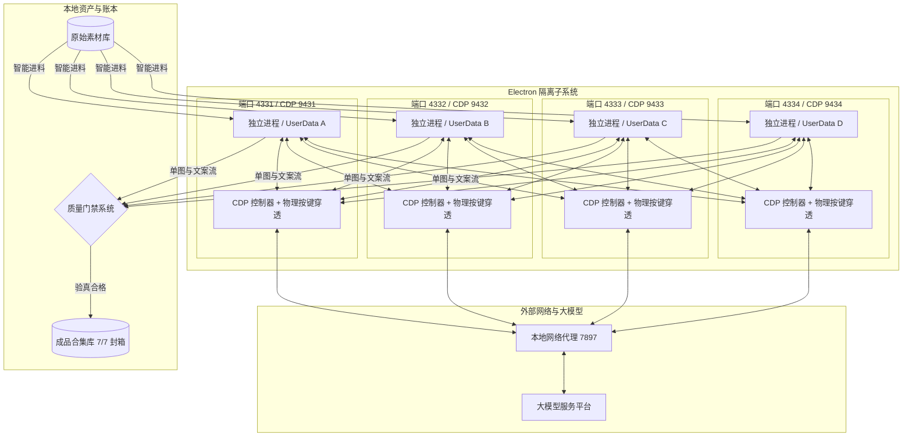

# 2.6.41-dev：精准团建分类优先于活动标签（本地未发布）

明确标为“精准团建”或“团建方案”的素材优先进入精准团建模板库；正文/标签中的“团建游戏”“趣味运动会”等活动词不再把 HR 服务策划误分到小游戏库。显式“团建游戏/破冰游戏”目录仍归小游戏。

定向回归 2/2，Python 编译检查通过；上海 HR 当前素材实测分类为 `team_building`。本地代码尚未接入活动桌面流程；本轮未调用模型或生成作品。

# 2.6.40-dev：A/B 守护进程跳过已运行实例（2026-10-17，本地未发布）

A/B 启动守护先探测各自固定 CDP 端口；端口已由原 Electron 实例监听时跳过重复拉起，不再删除 Electron `SingletonLock`。端口探测异常时保留现场并延后复查。定向测试 2/2 与 Node 语法检查通过；已用原主实例 PID 85616/80432 现场验证两守护都跳过重复启动，未重启 Electron 或 GPT 页面。A/B 生产队列仍未绑定当前 workId，生产续页尚未恢复。

# 2.6.39-dev：恢复 A/B 生图估值并修复旧降额迁移（2026-10-17，本地未发布）

A/B 浏览器页 localStorage 实测为 45 张/3 小时，但服务器持久设置文件已是 50/80/3；旧版迁移把前端缓存的 50 降为 45。共享源码现将新账号默认恢复到 50，并仅对确认执行过旧降额迁移的 45 缓存值做一次性恢复；更低的自定义值保留。定向回归 55/55 通过。活动实例接口当前超时，尚未在桌面端加载此修复或宣称恢复生产。

## 2.6.38-dev：Codex 模式默认值与技能配置同步（2026-10-14，本地未发布）

本地 Codex 模式打开时从同一份技能设置读取已保存值；若当前为“复刻重组”，界面不显示或选用外部固定模板。这个同步只负责模式读取和展示，仍不会自动新建 Codex 对话、发送提示词或启动生图。活动工作台进程尚未刷新。

## 2.6.37-dev：按计划页数完整交付（2026-10-12，本地未发布）

每套作品以任务计划的页数 N 为完成条件：计划 9 页就必须交齐 9 页；5/9 只能返修，不能标 PASS 或进入正式货架。随机模板资格与候选模板元数据、P1/P2 哈希一并校验。当前代码仅完成静态检查，活动服务未重载，真实产线尚待隔离回归和完整套图验收；旧网页 CDP 逐页构图/贴纸/AI 味 QA 尚未接入正式落架前置门禁。

## 2.6.36-dev：两条产线统一成品档案（2026-10-12，本地未发布）

本地 Codex 新成品写入 `metadata.json` 与 `manifest.json.deliveryMetadata`；GPT 网页/CDP 新成品写入 `metadata.json` 与 `GPT作品记录.json.deliveryMetadata`。档案记录来源原路径、归档路径、成品目录、模板与逐页映射、图片/文案 SHA、版本与质量/同步状态。缺失证据明确标记，不猜历史值。专项离线测试通过；没有因此宣称两条产线已实机整套跑通。

## 2.6.35-dev：内容制作页移除顶部执行总览卡（2026-10-11，未发布）

按用户反馈移除占空间的顶部执行状态卡，并清掉对应的渲染函数与样式；产线模式说明、后端能力状态和生产请求列表保留。定向 UI 回归 1/1，`node --check src/public/app.js` 与 `git diff --check` 通过。尚未重载桌面工作台，也没有新增真实生图或整套交付；两条产线六种组合仍未完成端到端验收。

## 2.6.34-dev：双线实际续跑与在线连接修复（2026-10-11，未发布）

在线 producer 的内存回收与生产共享 WebSocket 接收器会互抢，现将完整命令交换、重连与关闭串行化；专项测试 5/5，附件严格计数测试 4/4。A/B 均 HALTED、无 current_package 后已替换闲置旧进程，当前 PID 34668；浏览器与登录保留，批量领料保持暂停。新进程启动不代表模型生产验收。

独立固定模板 adapter 分开验证附件齐全与提示词发送就绪，使用原生输入并完整回读正文，缺图、多图、截断或已有草稿均拒绝发送。在线 T27 新会话学习正在实测；旧模板链接为空不能伪造 READY。两条产线的完整交付及三种制作模式仍未全部验收。

本地 Codex 已实际接续义乌 T27 测试套图，按 manifest 页码保留旧合格图继续缺页；实际张数和 SHA 以测试 manifest 为准。11 版本文案已落盘并通过现有检查。没有把单页图片、学习回复或程序测试计为完整成品。

飞书异常消息已由 feishu-main bot 发送并精确回读，message ID om_x100b63926cc980a4c295c873df246a1；总控卡更新 API 230075 独立记为 PENDING，不重发警报、不更换总控消息 ID。通知脚本回归 29/29。未推送 GitHub。

下一步：完成本地整套图片与交付；在线取得真实 T27 学习回执后执行同素材单套，不解除批量暂停冒进。


## 2.6.33-dev：完整套图与文案核验（本地开发，未发布）

新增同一请求的整套实物验收入口：按原素材逐页核对原生图 SHA、实际图片解码及 1086×1448 规范图，复用现行 11 版文案检查，并拒绝正文完全重复的版本。验收后界面显示“整套已核验 · 待交付”；正式归档和云端回读尚未接入，仍不计为完成。状态回读重新检查文件 SHA，文件变化后旧合格状态失效。

该项属于总计划 P09/P11 的部分实现，不代表两条产线、三种模式现场跑通。现有活动进程未强制重启，未发布 GitHub，未发送成功通知。

# 2.6.32-dev：工作台任务与对话技能接手（2026-10-10，本地开发，未发布）

- 本地任务卡增加“复制任务给 Codex”：包含同一请求编号、工作台地址与接手步骤，不另外选择素材或母版。
- 共享技能增加 workbench_operator：从现有后端读取、校验源文件、独占领取任务、提交生成回执并回读；没有第二套任务状态库。
- 自动打开带任务的 Codex 新对话尚未实现；按钮只复制说明。生成回报仍为待质检，不能当成作品交付完成。

# 本地开发 2.6.31-dev：在线模式额度告警说清来源与处理进度（2026-10-10，未发布）

- 在线模式额度告警现在固定说明来源平台、实例/会话、执行者/作品、问题影响、已做处理/验证以及下一步；任务退回共享队列和 B 实例领取未回读前，不再写成已完成。本机按网页提示估出的复查时间会明确标为估算。
- 公共异常卡使用同一人话格式，说明“收到异常事件”不等于“已恢复”。纯本地通知合同测试 2/2、Python 编译检查通过；本次不发飞书、不调用生图，活动 producer 不重启，运行中行为尚未验收。

# 本地开发 2.6.30-dev：CDP 附件整套完整性硬门（2026-10-10，未发布）

- 修复在线模式上传多张图片时只挂载部分附件仍可能达到旧 60% 门槛并提交的问题；现在必须观测到的附件数与本套预期图片数完全相等，否则阻止模型提交，避免缺页作品被误算成功。
- 附件计数不再使用“移除”按钮数量兜底；按钮不是图片凭据。上传预算仍按实际已挂载数记录，即使本套随后因缺页被拦截也不会低估本地预算。
- 离线回归 4/4、Python 编译检查通过。活动 CDP producer 已在运行中且不可安全热替换；此修复尚未加载到线上进程，未完成桌面/CDP 实机验收，未计真实作品。

# 本地开发 2.6.29-dev：统一双产线用户名称（2026-10-10，未发布）

- 内容制作现在把 GPT 网页/CDP 称为“在线模式”，把 Codex 客户端称为“本地模式”；CDP A/B 是在线模式下的两个实例，不再被误读为两条独立生产线。
- 三种制作方式仍是另一层选项；Gemini 生产已停用，工作台只留“历史记录”只读入口。离线合同测试只验证名称和状态映射，不等于真实模型生产、QA 或交付跑通。

# 本地开发 2.6.28-dev：停用 Gemini 团建生产（2026-10-10，未发布）

- 用户已要求停止 Gemini 团建生产。后端禁止新建 Gemini 请求、领取旧请求和写入生成回执；共享派单脚本拒绝 Gemini 直接调用。历史请求仍可只读查看。
- 当前有效范围为 CDP A/B 与 Codex API × 三种模式。真实模型生产、QA、归档与飞书闭环仍按逐条证据核验；本次未调用任何生图模型。

# 本地开发 2.6.27-dev：Electron 工作台黑屏修复（2026-10-10，未发布）

- 离线生产请求回执矩阵现覆盖 CDP A/B、Codex、Gemini × 三种模式，共 12 个执行器/模式组合；生成回执仍须真实执行器调用，且保持待质检状态。此为本地合同测试，不代表 3×3 实机生产闭环。
- A 实例主页面黑屏的根因是 native-assistant-overlay 标记被加到 body，而 CSS 把该标记整体设成隐藏。已从助手控件隐藏规则中移除这个整页选择器。
- 定向回归 1/1 通过；A 页面重载后 DOM 主体和 GPT 宿主区域恢复正常尺寸，定向窗口截图可见工作台。此修复不证明 GPT 会话创建/模板学习已完成。

# 本地开发 2.6.26-dev：请求领取与生成回执逐阶段回读（未发布）

统一产线请求现在可以按 requestId 回读、原子领取并提交逐页生成回执；Codex、CDP、Gemini 请求的后端状态与“内容制作”请求卡显示同一阶段。生成回执只证明执行器提交了匹配的本地文件、源页 SHA 与调用 UUID；状态保持“待质检”，不代表 QA、正式归档或飞书交付。该桥尚未自动唤醒任何模型执行器。

现场复核（2026-10-10 12:16 +08）：内容制作 API 4331/4332 间歇性无响应；B 的快速 runtime-info 路由无响应且 worker 仍活动，未强制重启。3 条逻辑产线×3 种模式的真实闭环仍为 0/9；昨夜网页互动的完整成品套数未核实。详见[最新交接](docs/HANDOFF.md)与[一页操作手册](docs/TWO-LINES-AND-THREE-MODES-USER-MANUAL.md)。

## 本地开发 2.6.25-dev：精确报告状态 DTO 缺字段（未发布）

内容制作面板现在能区分“服务声明 v4 但漏字段”和一般读取失败。出现这种合同错配时会指出具体字段，并提示安全空闲后更新或重载服务；不会用旧快照授权登记。该修复不代表模型执行或作品闭环。

## 本地开发 2.6.24-dev：统一状态快照补齐 profile revision 状态（未发布）

修复 `/api/production/state` 少返回 `capabilities.declaredProfileRevisionState` 的问题。服务端能力接口本来有这个字段，浏览器 schema-v4 校验也要求它；统一快照漏投影后，界面把整份状态判无效，导致产线与模板控件被禁用。新增服务端 DTO 到浏览器合同的直接回归断言。桌面现场尚未刷新；为避免干扰正在使用的 CDP B 窗口，待安全空闲时验收。

## 本地开发 2.6.22-dev：生产按钮与真实动作一致（未发布）

内容制作首页第一步按钮现在写“生成生产计划”，因为它实际只调用 `/api/production/plan`。检查计划后，按钮才显示“生成首张校准图（仅1次调用）”，并调用 `/api/production/run`。页面初始说明同步写清“核对后才会开始生图”。Codex API 登记按钮仍保持“登记这套制作请求”，不把请求登记伪装成开始生产。两步按钮合同与静态资源版本回归 3/3；产线状态/请求合同 39/39；`node --check src/public/app.js` 和 `git diff --check` 通过。整份工作台 UI 测试仍有 31 项失败（506 项中 474 通过、1 跳过），其中失败涉及其他导航、GPT 运行与帮助模块，本次不宣称全量测试通过。本变更未连接 Codex/Gemini 执行器，也未完成三条产线端到端验收。

## 本地开发 2.6.21-dev：运行状态接口不匹配时明确报错（未发布）

`/api/production/state` schema v4 同时提供设置能力、请求台账和每个执行实例的运行状态回读。内容制作顶部的状态卡片严格消费这份快照：CDP 只展示带新鲜度的旧执行器回报，过期时不显示旧排队数；Codex 与 Gemini 缺少工作台回执时会明确标为未观测/未接通。若运行中的服务返回旧 schema，页面会直接显示界面期望版本与服务实际版本，不再只显示笼统读取失败。

定向回归 39/39；现场 B/4332 在 2026-10-10 04:37（+08）回读 `2.6.20-dev` 与 schema v4，说明守护进程自行拉起后已载入统一运行态接口。该快照报告 CDP A 离线、B 异常，Codex 未观测、Gemini 未接入；请求数为 0。接口状态可回读不等于三线生产闭环。B 的 Electron/Codex 页面仍在使用，不主动重启；实际桌面视觉及模型生产仍未验收。

活动 Codex 秋季作品《9-10月！秋季杭州团建好去处推荐！》目前 7 张计划图均未生成，文案 11 版本 QA 通过。最近一次明确额度错误给出的重置时间为 2026-10-10 12:19（+08），按流程最早 12:24 再探测；本轮时间为 04:37（+08），未提前调用生图。

另经只读审计，`D:\AICode\产线自动化综合测试_20261008\run_three_pipelines_test.py` 产出的 22 张三线测试图来自本地 Pillow 绘制，并未调用 CDP/Codex/Gemini 执行器；旧报告中的“实机全 PASS”不能作为三线跑通证据。

## 本地开发 2.6.19-dev：三产线、模板选项共用状态合同（未发布）

`/api/production/state` schema v3 把三条主线（CDP、Codex API、Gemini）、三种模式、执行实例和服务端核验过的模板选项放在同一份后端快照中；CDP 的 A/B 是 CDP 下的两个实例，不再被当成两条主线。界面模式选项、模板选项、能力说明、登记按钮与各线请求台账都从该快照投影。提交时服务端会再次核验模板编号及 P1/P2 实物哈希。

快照只说明“能否登记”与“执行器接到哪一步”，不能把已登记说成已生图；Gemini 执行器、模型实跑、QA、正式归档与飞书回读没有对应凭证时会明确显示未接通/未知。额度和生产阶段状态尚未接入此合同。

验证：请求路由、客户端投影与 UI 合同定向测试 36/36；`node --check src/public/app.js`、`git diff --check` 通过。当前只读回读 B/4332 得到 schema v3、3 条主线、3 种模式、0 条登记请求；服务实际下发的 HTML 含 Codex 母版选择器，客户端脚本要求 v3 并校验模板选项。快照内有 1 套有效模板。4399 是另一块生产大屏，`/api/production/state` 不存在；不能混为一个接口。以上是 HTTP/静态资源合同验收，不代表 Electron 视觉验收或真实模型生产。未调用模型、上传、QA、正式归档或飞书写入。

## 本地开发 2.6.17-dev：交接实例绑定与聊天操作入口（未发布）

容器交接现在把目标产线与实例绑定到请求和接收回执；内容制作端只有确认实际接收实例与目标一致才接受素材，容器在异步等待期间切换 A/B 实例也不会把旧实例回执记到新实例。跨端统一技能以当前 AI 对话为生产入口；工作台用于选料、查看和辅助操作，不能代替实际模型执行与交付证据。

验证：内容制作接收端与交接回归 17/17；容器交接/UI/配置定向回归 20/20；容器完整 `npm test` 58/58；`node --check src/public/app.js` 通过。未调用模型、未上传素材、未重启工作台/Electron；桌面显示与真实模型端到端仍待验收。

## 本地开发 2.6.16-dev：完整素材夹交接边界（未发布）

容器的“选这套素材”只允许选一个末级、含图片的作品文件夹；不会从分类路径展开并选中多套作品。内容制作接收端返回 `SELECTED_NOT_STARTED` 后才显示已带入，仍须人工检查产线、模式和模板并明确开始。Codex API 与 Gemini 没有素材接收回执时只显示容器当前选择，不冒称其已收到素材。

定向回归覆盖：完整文件夹选择、分类路径拒绝、选择不启动生产、无接收回执时不谎报接入。未调用模型或上传素材，未重启工作台/Electron，未做桌面实机验收。

## 本地开发 2.6.15-dev：CDP 附件额度预检与让位（未发布）

本地源码已实现并通过离线回归测试：旧 CDP producer 上传前按整套附件数预检 3 小时 / 80 个附件安全线，并以同一请求号关联工作台当前账号账本。已挂载附件会在提示词提交前记账，预算不足时释放素材给另一条空闲 CDP 实例；超过单套上限的素材标记为待拆分，不计生产失败。工作台 API 不可达时使用本地账本兜底。该安全线不是网页官方余量；正在运行的 producer 尚未加载此改动，实机效果待验收。

三产线 × 三模式目前仍未完成实机闭环：9/9 只通过请求准备。参见[操作手册](docs/TWO-LINES-AND-THREE-MODES-USER-MANUAL.md)与[本次开发交接](docs/HANDOFF.md)。

## 本地开发 2.6.14-dev：三条产线与三种模式准备器（未发布）

新增 [团建生产线操作手册](docs/TWO-LINES-AND-THREE-MODES-USER-MANUAL.md)，区分 CDP A/B、Codex API 与独立 Gemini 执行入口，也区分三种模板模式与任务类型。离线回归验证任务准备与回读，不将其描述为真实模型生产；CDP/Gemini/Codex 的全流程执行、QA、正式归档和飞书回读仍须逐线实机接通验收。

验证：三模式技能合同 39/39；工作台请求/API/UI 26/26；隔离临时素材的 3 条产线 × 3 种模式请求准备 9/9，其中模式 2 用两套临时候选验证稳定抽选和哈希回读。以上不是实机生产验收。未发起模型调用、真实上传或飞书写入；未刷新运行中的工作台/Electron。

## 本地开发 2.6.12-dev：CDP 账号额度账本（未发布）

CDP 产线按账号窗口记录滚动上传附件数与生图数，默认安全线为 3 小时 80 个上传附件，并在生产面板显示本地记录、账面余量和触顶状态。修复普通 CDP 任务因没有 API 请求编号而被漏记的问题；只有成功提交后的自动生产上传计数入账，随套文案文件也计为附件。额度是工作台本地估算，不代表网页官方剩余额度；修复前和网页内其他操作不会自动补录。

触顶只影响当前 CDP 账号窗口。已启用账号轮换模式时，现有调度器会在安全收尾后选择下一个可用 CDP 窗口；默认切换设置未改，也不会跨到尚未接入额度计数/执行器的 Gemini 或 Codex API。显式账号额度提示可触发配额暂停，普通 HTTP 429、网络限流和超时不会单独判为账号额度耗尽。

验证：CDP 配额视图、账号轮换、扩展账本回归 34/34；配额相关工作台 UI 回归 3/3；Node 语法检查通过。未重启或刷新正在运行的 CDP/Electron 窗口，未调用模型或上传素材，代码尚未部署。

## 本地开发 2.6.11-dev：固定模板对话操作包（未发布）

Codex API 面板新增“首次设置母版”和“制作本套素材”两段可复制指令。它们按当前真实模板给出 P1/P2 参照路径，并把工作范围限定为一个完整素材文件夹；换新对话时提示重新附上模板。复制的是文字指令，不会替用户建对话、附加文件、调用模型、生图或归档。目录索引里的文件名也不算附件回执。

联合离线回归 42/42；`node --check src/public/app.js` 与 `git diff --check` 通过。未重启工作台或 Electron，未做桌面实机验收、模型调用、正式入库、飞书写入或发布。

## 本地开发 2.6.10-dev：旧生产启动器保留单实例锁（未发布）

修复旧 `launch_producer_daemon.py` 在启动前先删除 `producer.pid` 的行为。启动器现在只负责拉起并记日志，锁仍由 producer 本身校验和持有；遇到活动锁时不能由启动器绕过。补充回归覆盖“已有 PID 锁字节不变”和“脚本不存在时不创建运行目录/不派生进程”。本次只跑隔离单元测试，没有实际调用启动器、重启或新开 producer，也未验收原生模型生产。

验证：`python -B -m unittest scripts.test_launch_producer_daemon -v` 2/2；Python 编译检查通过。未发布、未触碰作品/队列。

## 本地开发 2.6.9：登记状态随当前作品切换（未发布）

Codex 面板只在请求台账回读到同一产线、同一完整素材文件夹和同一真实母版时，才把“请求登记”步骤标为完成。切换素材或母版会撤销旧请求对当前步骤的影响；请求卡片明确显示“执行器未接入”，登记仍不等于生图或交付。固定网页会话的复用仍要求真实学习回执；Codex 原生生图没有持久会话绑定。

验证：面板请求 UI 3/3、请求合同 8/8、服务端请求路由 11/11；语法和 `git diff --check` 通过。只验证本地源码与离线流程，未重启工作台、未连接执行器、未做桌面实机验收或发布。

## 本地开发 2.6.8：Codex 单套制作驾驶舱（未发布）

Codex API 面板改成单套工作台：清楚显示完整素材夹、真实母版、五步流程和最近登记的请求。列表只从请求 API 回读 SHA 绑定记录，显示“已登记、尚未生成”；状态不靠装饰性进度条推测。跨面板母版选择只有精确匹配现有母版 ID 才会选中。Codex API 每次生图都要携带母版参照；固定网页会话的“一次学习、后续只交素材”属于 CDP 会话模式，必须有账号/会话/母版学习回执。自动领取、模型执行、质检、入库与飞书交付仍未连接。

验证：`node --check src/public/app.js`；`node --test src/public/production-request.test.js tests/production-request-ui.test.js` 9/9；`git diff --check`。仅本地源码与离线回归，未重启工作台、Electron、生产器或账户，不代表桌面实机验收或发布。

## 本地开发 2.6.7：Codex 请求登记状态说清楚（未发布）

Codex 产线面板现在明确区分“登记请求”和“开始生产”：提供单套完整素材 + 母版请求登记、请求回读、当前步骤和执行器边界说明，不再宣称这页会自动生图或直接入库。自动领取/生图执行器仍未连接；登记回执不能计作作品交付。定向测试 `node --test src/public/production-request.test.js` 4/4、`node --check src/public/app.js` 通过；Electron/工作台实机展示仍待验收，本地改动未发布。

## 本地开发 2.6.6：真实制作请求登记与回读（未发布）

Codex 面板按钮由仅追加日志改为调用现有 production 路由的 POST /api/production/requests/prepare；单个完整素材文件夹与单一母版才能提交。后端从服务端私有配置解析素材根和母版实物，调用三模式技能真实 CLI 的默认准备路径，保存不可变请求并回读 SHA；不传 --execute、不生图、不写正式库、不发送飞书。GET /api/production/requests 与“查看已登记请求”用于超时后核对，准备请求不算作品完成。

三条产线共用请求合同，补充要求参与请求身份；同输入返回同文件。当前只配置已核实 T79 的准备映射，A/B 实际母版会话学习与模型执行尚未验收。本轮定向自动回归 33/33（含后端准备接口 14 项，并通过隔离 HTTP→Python→文件 SHA→GET 回读）；技能 35 项为此前验证。运行实例仍未加载新路由，当前 4331/4332 的新接口返回 404；因此不称三线已实机跑通。

# AI 图文批量生产控制台

## 本地开发 2.6.5：三模式技能自包含执行器（未发布）

真实固定会话执行器已移到 `.agents/skills/teambuilding-production-3modes`，该技能包含唯一 Python 实现、配置样例、依赖、运行合同与全部 34 项离线测试，单独复制技能即可部署。App 历史 scripts 入口与测试只委托技能；通过 `TEAMBUILDING_3MODES_SKILL_ROOT` 或相对仓库能力路由定位，缺技能明确失败，禁止旧 producer 回退。

验证：技能总控与执行器 34/34 通过；App 兼容入口回归同一 17/17。当前面板按钮仍只登记、执行器未连接。真实母版学习/账号绑定、DOM、原生下载、完整套图 QA/11文案/飞书闭环未实机验收；未构建、提交、发布或调用模型。见 [执行器入口说明](docs/ISOLATED-CDP-ADAPTER.md)。

## 本地开发 2.6.3：固定母版流程可见性（未发布）

CDP 的“接着当前对话做”现在显示母版会话绑定状态和四步制作流程。仅配置一个会话地址不代表已经学过母版：账号、母版、会话及学习回执必须一致，才能显示“母版会话已核实”。新对话模式同样显示母版参照核实状态和逐套步骤，按每套重新发送母版处理。

Codex 原生生图按每次调用传入母版参照处理，不冒充已初始化的网页会话。现有 Codex 按钮明确为“登记制作指令”，状态显示“执行器未连接”；接收母版选择只说明实物待核实，验收后才能归档。本次增加的是只读流程投影和诚实界面提示，没有新增生图执行器。

验证：`node --check src/public/app.js` 通过；`node --test src/public/fixed-template-session.test.js tests/container-handoff.test.js` 为 26/26 通过。尚未在本项目运行实例或 Electron 容器内验收这些变更；未构建、提交或发布安装包。

## 本地开发 2.6.2：容器素材接收握手（未发布）

容器通过 `webview.executeJavaScript` 调用 `window.receiveContainerHandoff({ type: "LOAD_MATERIAL_FOLDER", requestId, folderPath, folderName, images })`。接收端仅按当前已加载素材索引中的规范化绝对路径选择帖子或分类内全部帖子，成功回执为 `{ ok: true, requestId, stage: "SELECTED_NOT_STARTED" }`。未知、歧义、未加载或运行中的素材请求返回 `{ ok: false, requestId, error }`。名称和图片列表不用于创建素材或证明成功。

握手只选择素材，不上传、不启动生产。Codex 面板按钮仅记录“制作指令已登记，尚未开始生产”，当前未接入执行器。离线验证：`node --test tests/container-handoff.test.js`；本轮未重启或加载运行实例，未构建或发布新版本。

<p align="center">
  <strong>专为新媒体工业级矩阵打造的四核多实例、无人值守 AI 图文自动化生产中枢</strong><br>
  四核物理进程隔离 · CDP 物理按键穿透自愈 · 20MB 超大缓冲区防溢出 · 4K 级图文质量门禁
</p>

<p align="center">
  
  
  
  
  
</p>

---

## 🎯 痛点与初衷：为什么需要它？

在多账号、矩阵化自媒体内容工业化生产实践中，传统网页端操作和单脚本批量处理面临四大致命瓶颈：
1. **多账号串号与环境污染**：传统浏览器多开或多标签页共享相同或交叉的存储上下文，极易发生 Cookie 串扰、账号混淆，甚至触发平台的安全风控；
2. **长对话大 DOM 树导致连接闪退**：CDP 控制协议在读取数十轮上下文的长对话大页面时，默认缓冲区过小，极易抛出 `sent 1009 (message too big)` 异常导致生产进程骤然崩溃；
3. **断流假死与无头死等**：大模型在生成超长文案或批量图片时，若前端扩展偶发断流、停留在“等待输入 1 确认”时，常规脚本只能无限挂起，导致整个通宵的无人值守流水线全面瘫痪；
4. **下载损坏与图文脱节**：传统整包 ZIP 下载极易因网络波动损坏，且经常出现“只有图片没有文案”或“文案齐全却缺图”的次品事故。

**AI 图文批量生产控制台正是为彻底打通大规模生产断层而研发——以“四核物理进程隔离”、“底层 CDP 按键穿透自愈”、“20MB 防溢出管道”与“严密质量门禁”，实现 24 小时连续高产的工业级闭环。**

---

## 🌟 四大核心技术支柱

```
┌────────────────────────────────────────────────────────────────────────┐
│                        AI 图文批量生产控制台 核心矩阵                  │
├──────────────────┬──────────────────┬─────────────────┬────────────────┤
│  🚀 四核物理隔离 │  🛡️ 按键穿透自愈 │  📥 智能进料封箱│  💎 质量严密门禁│
│  A/B/C/D 四实例  │  底层 KeyCode 13 │  递归检索素材库 │  6+ 张 4K 大图 │
│  独立端口与会话  │  20MB WebSocket  │  7/7 满编自动进料│  哈希去重与文案│
│  互不串号故障熔断│  显式本地代理分流│  合集自动归档封箱│  坏卷毫秒级剔除│
└──────────────────┴──────────────────┴─────────────────┴────────────────┘
```

### 1. 🚀 四核物理级多实例隔离架构
* **进程与存储绝对隔离**：分为 A、B、C、D 四个完全独立的桌面子系统，分别绑定专属 HTTP 端口（4331–4334）与独立 CDP 调试端口（9431–9434）；
* **独立环境与用户数据**：每个实例独享物理 `userData` 存储路径与 Cookie 凭据，互不串号、互不干扰；单个实例的临时调试或故障重启绝不波及其他三个实例的连续生产。

### 2. 🛡️ 底层 CDP 物理按键穿透与连接自愈
* **物理级击发自愈**：当监测到模型完成上一阶段生成但前端扩展因事件丢失停留在确认阶段时，系统通过底层 Chrome 调试协议直接模拟真实的物理按键（WindowsVirtualKeyCode 13 回车）完成自动点火与状态推移，彻底消灭“卡死死等”；
* **20MB 超大 WebSocket 缓冲区**：彻底重构底层长连接通信通道，将默认缓冲区大幅扩容至 20MB，彻底终结长对话 DOM 树提取时的 `1009 (message too big)` 崩溃顽疾；
* **精准代理与本地分流**：外网请求精准调度至本地代理服务（7897），本地 API 与调试端口强制直连，网络链路 100% 畅通稳定。

### 3. 📥 全自动智能进料与满编封箱
* **素材库递归穿透检索**：自动递归扫描全量客资素材库，智能提取未排产的原图选题，自动注入提示词流水线；
* **合集自愈闭环与自动封箱**：实时监控各合集生产进度，精准达成 7/7 满编后立即自动封箱归档，并无缝进入下一编号合集继续生产，真正实现“通宵无人值守”。

### 4. 💎 工业级质量门禁与 4K 原图直存
* **单图直存零损耗**：告别容易坏包的压缩包下载模式，采用全自动 4K 原图直接落盘与双端成稿文案毫秒级解析配对；
* **四重严密质量检测**：每套作品必须通过“文件哈希去重”、“$\ge 6$ 张高清实景图完整度”、“双端文案结构性解析”与“坏卷自动熔断”四重门禁，确保产出成品的达标率达到 100%。

---

## 🚀 极简启动与协同

```mermaid
graph LR
    A[实例 A (端口 4331)] & B[实例 B (端口 4332)] & C[实例 C (端口 4333)] & D[实例 D (端口 4334)]
    A & B & C & D --> E[独立 CDP 驱动与自愈]
    E --> F[共享素材进料]
    F --> G[4K 原图与文案产出]
    G --> H[质量门禁 7/7 封箱]
```

### 1. 独立启动指定生产实例
你可以根据当前硬件负荷与账号规划，单独拉起任意一个或多个实例：
```powershell
# 启动实例 A（账号 1，管理端口 4331，CDP 9431）
.\start-instance-a.ps1

# 启动实例 B（账号 2，管理端口 4332，CDP 9432）
.\start-instance-b.ps1

# 启动实例 C（账号 3，管理端口 4333，CDP 9433）
.\start-instance-c.ps1

# 启动实例 D（账号 4，管理端口 4334，CDP 9434）
.\start-instance-d.ps1
```

### 2. 实时生产状态查看
每个实例启动后，可直接通过浏览器访问其独立管理页面：
- 实例 A 控制台：`http://127.0.0.1:4331`
- 实例 B 控制台：`http://127.0.0.1:4332`
- 实例 C 控制台：`http://127.0.0.1:4333`
- 实例 D 控制台：`http://127.0.0.1:4334`

各实例页面提供实时的生产进度、页面状态预览、检查点查看与手动调试干预入口。

---

## 🏗️ 系统拓扑架构



---

## ❓ 常见问题解答

### Q1: 为什么要采用多进程独立实例，而不是单窗口内开 4 个标签页？
在 Chromium 架构中，单进程内的多个标签页共享同一渲染管线与事件循环，一旦某个标签页因长会话造成内存泄漏或崩溃，会导致所有正在生产的标签页全军覆没。此外，不同账号登录态必须完全隔离，四进程独立模型在系统资源充足的情况下具备最顶级的健壮性。

### Q2: 生产过程中遇到网络抖动怎么办？
系统具备多层重试与自愈机制：首先通过本地代理隧道保持连接稳定；其次针对通信管道设定了心跳检测与重连逻辑；若出现断流，系统会触发物理级按键点火推进会话，无需人工在深夜值守排查。

### Q3: 生产完成的作品存放在哪里？
每套作品经质量门禁校验合格后，会自动保存至对应合集目录中，包含完整的 4K 原图文件与配对的文案文件，并由去重账本登记，防止后续环节混淆。

### Q4: 详细的版本历史与技术演进细节在哪里？
完整的版本变更纪要与生产优化历程请查阅 [`CHANGELOG.md`](CHANGELOG.md)。

---

## 📄 开源与商业许可

本项目遵循 [MIT 开源许可证](LICENSE)。

## 本地开发 2.6.23-dev：CDP 固定模板消费与回执边界

CDP 桌面桥只接受明确的固定模板模式，并会在 GPT 扩展实际附件列表中核对 P1/P2 文件字节、SHA-256 和输入框预览后，回写原始请求的 `MATCH` 回执。`MATCH` 只证明模板附件已被本次浏览器输入接收；当前固定模板自动生产 worker 尚未接通时，界面明确返回“未开始生产”，暂停该窗口以免下一套混入，不会把上传显示为作品成功。模式 1/2 暂不支持，会明确拒绝。

Codex API 请求准备会先拉取新鲜的统一状态快照，并在提交和回读中绑定同一条产线、模式、模板与配置版本。定向回归 15/15；未启动浏览器、模型或飞书，桌面实机验收仍待安全窗口进行。

---

## 📝 变更记录

| 日期 (时间) | 执行者 | 记录 |
|---|---|---|
| 2026-09-17 23:11 | 💻 本地 PC / 反重力 | 初始化创建文档并补齐变更记录历史 |

## 在线模式：用一句话创建计划（2.6.32-dev，本地代码，运行验收待完成）

1. 在素材区输入关键词即时筛选，或直接写完整需求；有需要就勾选整套素材。
2. 选择制作方式、模板；固定模式可在计划中保存多个模板候选，每套开工前记录实际选中模板。
3. 点击“创建制作计划”。没有素材也能保存，状态是“等待找到素材”；不会偷偷选其他题材，也不会立刻生图。
4. 点击“查看计划进度”，展开计划，点“复制计划给 AI”，粘贴到操作对话。AI 读取同一后端计划，每素材一子任务；A/B 属于同一在线模式，可关联到同一父计划。
5. 图已生成仍显示待质检，只有文案、QA、归档和交付证据齐全才能算完成。目前尚未接通完整交付状态汇总，界面不显示虚假的完成数量。

计划不是硬链接副本，也不是另一本手工表格：现有 production-jobs/plans 保存原始需求与来源路径，子项引用 production-requests 的真实编号。前端和技能读同一份数据。文件夹名会因 Windows 字符限制安全处理，但原素材路径和原文件夹名独立保留；原标题必须从原素材核实，未知时不能猜。

谷歌云盘搜索/上传、谷歌日历完成通知尚未连接；当前没有云端端到端通过证据，不声称已可用。不要删除原素材或把内部 plan.json 当成云端成品。自动创建 Codex 对话、后台自动执行新计划、完整交付回写仍是后续待补工序。

## 2026-10-15 手动下载按钮兼容修复（待运行验收）
GPT新版generated-image-preview/search-message容器无旧conversation-turn节点，修复原油猴脚本生成图识别、图组统一与下载路径偏好；保留下载本组和下载并打包入口。下载配置从临时测试路径恢复为C盘Downloads及正式成品库，原配置已备份。JS语法检查通过。A正在回应，未刷新、未重启；按钮加载、C盘下载及剪贴板TXT端到端验收未完成。
