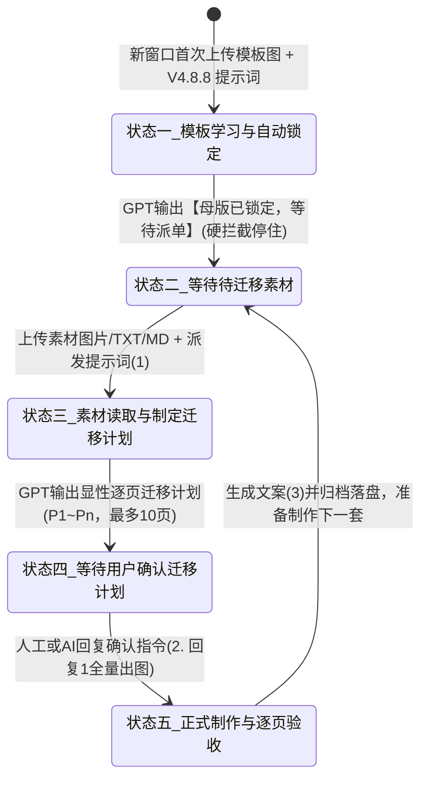

# 内容制作系统标准作业程序规范 (SOP v2.0 · 权威正本)

> **版本**：`v2.0.0-canonical`  
> **制定时间**：`2026-10-31`  
> **适用模块**：`D:\AICode\工具开发\projects\content-production-app`  
> **实机真源**：Quicker 剪切板【团建】收藏最新真源《轮播母版迁移器 V4.8.8｜完整修复终版》（源码固化于 `src/prompts/v4.8.8.txt`）及配套 3 阶执行提示词。  
> **最高原则**：本文件是内容制作（小红书/抖音图文生成与分发）的**全系统唯一权威标准规范（Single Source of Truth）**。此前历史积累的 54 轮口述补丁草稿（`内容制作模块加技能设计成技能SOP.md`）全部废除并归档；任何代码修改、Agent 技能执行与人机协作必须 100% 遵照本 SOP 执行。

---

## 一、 核心工作哲学与人机双轨准则

### 1.1 业务真实性铁律（V4.8.8 核心定标）
在图文生成中，必须严格恪守以下七大核心原则：
1. **【母版锁定】**：母版决定视觉形式与排版骨架，素材不能反客为主破坏母版规范；
2. **【B类素材仅供参考】**：待迁移原图只供理解场景、人物、玩法与空间关系，**不得切图、裁剪、放大或直接拼接成正式照片画面**；
3. **【新生成是默认】**：正式成品的照片画面必须独立重新生成实拍质感，不能用旧图片像素拼凑；
4. **【高清无水印硬锁】**：严禁复制或新增任何来源水印、账号标签或未授权修饰；
5. **【真实优先于精致】**：现场手机/普通相机抓拍质感优先于商业广告精修大片；场景关系忠实，但生成图不得冒称现场原始未动图；
6. **【页面数量有机编排】**：单套作品由素材信息量动态决定，最多 10 页，全部独立 3:4 竖版成品图；
7. **【验收逐页过关】**：未经逐页核验不得声称合格。

### 1.2 人机双轨（Dual Operability）
系统设计必须保证**人与 AI 具备完全平等的双轨操作能力**，底层状态与文件结构完全同一：
- **人手动操作 (Human Manual)**：通过工作台控制台面板点击按钮、选取素材、查看 GPT 计划、点击出图、复制文案；
- **AI 自动执行 (Agent Autonomous)**：Agent 技能通过调用后端提供的操作动作（`/api/production/actions/*`）按步骤触发，与人工操作无缝同频；
- **无多余术语**：抛弃所谓的“双端网关”等抽象概念，本质就是“同一个底层目录与状态，既能人工点按钮，也能 AI 调接口替代人工”。

---

## 二、 核心“提问”模块：V4.8.8 五阶状态机

整个内容制作控制台，**80% 的核心功能集中在“提问与生产流交互”**。
系统严格执行《轮播母版迁移器 V4.8.8》定义的唯一权威 5 状态机：



---

## 三、 四段标准提示词正文（Quicker 剪切板团建分类权威真源）

所有提示词已严格固化在 `src/prompts/` 目录中，严禁私自篡改正文。

### 1. 阶段一：母版锁定提示词 (`src/prompts/v4.8.8.txt`)
- **适用时机**：全新对话窗口首次启动；
- **操作内容**：上传目标模板切片图（封面 + 内页）+ 完整 1,487 行《轮播母版迁移器 V4.8.8｜完整修复终版》正文；
- **预期输出**：
  ```markdown
  【母版分析结果】
  母版名称：...
  封面结构：...
  内页结构：...
  字体与配色：...

  【模板已学习并自动锁定】
  当前窗口唯一母版：...
  当前状态：等待待迁移素材

  【母版已锁定，等待派单】
  ```
- **硬性门禁**：停在当前状态，**严禁主动出图，严禁主动出计划**。

---

### 2. 阶段二：素材派发提示词 (`src/prompts/step1_material_dispatch.txt`)
- **适用时机**：母版锁定后，上传待制作选题的原图素材、行程 `MD`、文字 `TXT`；
- **标准文本**：
  ```markdown
  沿用本窗口最初确认的唯一视觉母版。

  本次上传的全部图片、TXT、MD 都是待迁移素材，不是新模板。

  请按照《轮播母版迁移器 》完整读取素材，先输出显性逐页迁移计划，最多10页，暂时不要出图。

  重点执行同场景真实去重：
  - 保留场景与空间关系。
  - 按需更换人物、动作、穿搭和站位。
  - 更换小物件、食物组合和物品摆放。
  - 合理改变拍摄角度、距离和构图。
  - 保持真实拍摄质感，不做过度美化，不生成商业精修大片。

  计划完成后等待我回复“1”。
  ```
- **预期输出**：显性逐页迁移计划（P1~Pn 页码、单页主题、对应参考素材、画面构图、文字要素与去重策略），停下等待确认。

---

### 3. 阶段三：确认出图提示词 (`src/prompts/step2_confirm_plan.txt`)
- **适用时机**：计划核对无误后触发批量生图；
- **标准文本**：
  ```markdown
  1，确认出图。
  沿用本窗口最初确认的唯一视觉母版。
  按已确认计划批量出图，全出。
  重点执行同场景真实去重，保持真实拍摄质感，不做过度美化，不生成商业精修大片。
  逐页输出独立3:4竖版正式成品图。
  ```
- **执行效果**：GPT 调用 `image_gen.text2im` 工具，**一气呵成批量生成全部 6~10 张 3:4 竖版成品图**。

---

### 4. 阶段四：文案生成提示词 (`src/prompts/step3_copywriting.txt`)
- **适用时机**：整套图片全部生成并落盘后；
- **标准文本**：
  ```markdown
  请先读取本窗口【当前这一套作品】的文字、TXT、MD及必要图片，准确提取地点、玩法、时长、餐饮、住宿等事实。不得混用历史作品、视觉母版或其他批次的信息。

  然后实际访问并严格执行以下GitHub公开技能最新版（唯一权威来源）：

  https://raw.githubusercontent.com/zwmopen/skills-public/main/skills/teambuilding-copywriter/SKILL.md

  执行要求：

  1. 按技能中的【默认快速生产】流程处理，优先读取文字；图片按需识别，不默认OCR或重复分析。
  2. 参考模板和黄金原稿按照技能要求按需读取，不扫描全部历史语料。
  3. 生成完整五版文案，每版800–950发布字符，风格独立、内容丰富、自然，不编造事实。
  4. 高密度第3、4版在素材充分时必须包含具体时刻的D1/D2或单日参考时间轴。
  5. 严格执行技能规定的小红书、抖音、标题、话题、排版和违规风险规则。

  固定交付：

  ① 五个独立、可直接复制的完整文案代码块。

  ② 一个五版正文逐字一致的完整MULTI合并代码块。

  ③ 实际创建UTF-8编码的"文案.txt"，内容与MULTI逐字一致，并提供真实下载链接。

  交付前只做必要的事实、字符数、时间轴、话题及文件一致性检查。

  素材充分时直接一次性交付，不反复询问、不展示冗长分析、不省略任何版本。无法读取的必要资料或无法创建的文件，应如实说明。
  ```

---

## 四、 工作台“提问与生产流”面板设计与交互规范

工作台的界面布局必须围绕上述 5 状态机与 3 步核心交互展开：

```
┌────────────────────────────────────────────────────────────────────────┐
│ 顶栏槽位：[a · zwmrpg]  [b · upvote]  [c · donnap]  [d · orland] ...   │
├────────────────────────────────────────────────────────────────────────┤
│ 【生产控制台：当前会话状态：状态二 · 等待待迁移素材】                   │
│                                                                        │
│ ┌─ 步骤 1：母版锁定 ────────────────────────────────────────────────┐ │
│ │ 母版选择：[ T01-轻奢团建小院 ▼ ]  [查看母版图]                      │ │
│ │ 提示词：已加载《轮播母版迁移器 V4.8.8》                              │ │
│ │ [ 发送母版学习 (锁定) ]   状态：✅ 已锁定（【封面全景 × 内页多格】） │ │
│ └────────────────────────────────────────────────────────────────────┘ │
│                                                                        │
│ ┌─ 步骤 2：素材派发与逐页计划 ──────────────────────────────────────┐ │
│ │ 素材选题：[ 03-怀柔独栋泳池小院2日游 ▼ ] [刷新素材] (含12图+行程MD)  │ │
│ │ 提示词：1. 和素材一起发，补充原料，补充素材模板迁移                  │ │
│ │ [ 派发素材并生成计划 ]                                              │ │
│ │ ────────────────────────────────────────────────────────────────── │ │
│ │ 计划预览区 (折叠面板)：                                            │ │
│ │  - P1: 封面 · 独栋院落全景 + 大字标题 "北京怀柔团建新地标"          │ │
│ │  - P2: 院落设施 · 恒温泳池与草坪烧烤区 (真实去重: 更换休闲站位)    │ │
│ │  - P3: 室内娱乐 · KTV与台球厅体验 (更换桌台摆设与光影)              │ │
│ │  ... 共 8 页                                                       │ │
│ └────────────────────────────────────────────────────────────────────┘ │
│                                                                        │
│ ┌─ 步骤 3：确认批量出图 ────────────────────────────────────────────┐ │
│ │ 快捷确认指令：2. 出图阶段，确认计划 ("1，确认出图...")              │ │
│ │ [ 🚀 确认出图 (回复 1) ]  [ ⏹ 暂停/中止 ]                           │ │
│ │ ────────────────────────────────────────────────────────────────── │ │
│ │ 实时成图瀑布流 (共 8 张)：                                         │ │
│ │ [ P1 封面 ]   [ P2 内页 ]   [ P3 内页 ]   [ P4 内页 ] ...           │ │
│ │ [放大/另存]   [单页重新生成]                                        │ │
│ └────────────────────────────────────────────────────────────────────┘ │
│                                                                        │
│ ┌─ 步骤 4：文案生成与成品落盘 ──────────────────────────────────────┐ │
│ │ 执行技能：teambuilding-copywriter (GitHub 权威正本)                  │ │
│ │ [ 📝 生成五版文案并下载文案.txt ]   [ 📁 打开本地成品文件夹 ]         │ │
│ └────────────────────────────────────────────────────────────────────┘ │
└────────────────────────────────────────────────────────────────────────┘
```

---

## 五、 本地文件落盘与归档规范

每套成品在通过逐页核验后，落盘至统一目录结构：
```
成品库/
└── {计划名}/
    └── {地区名}/
        └── {作品名}/
            ├── P1-封面.png
            ├── P2-内页-院落全景.png
            ├── P3-内页-泳池露台.png
            ├── ...
            ├── 文案.txt           (UTF-8编码，五版文案与MULTI合并块)
            ├── 迁移计划.md        (GPT输出的逐页迁移计划存档)
            └── metadata.json      (包含账号Slot、模型、用时、生成时间)
```

---

## 六、 规范落地与历史交接

1. 提示词正本：
   - `src/prompts/v4.8.8.txt` (V4.8.8 完整版总提示词)
   - `src/prompts/step1_material_dispatch.txt` (素材派发)
   - `src/prompts/step2_confirm_plan.txt` (确认出图)
   - `src/prompts/step3_copywriting.txt` (文案生成)
2. 历史归档：
   - 旧版口述 845 行已封存于 `docs/archive/内容制作模块加技能设计成技能SOP_legacy_845lines.md`。
