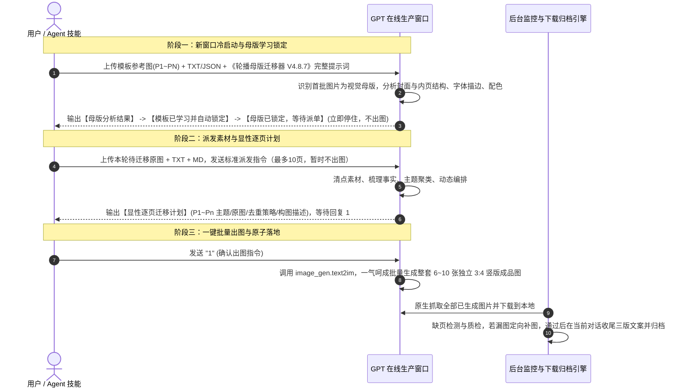

# 内容制作系统标准作业程序规范 (SOP v2.0 · 权威正本)

> **版本**：`v2.0.0-canonical`  
> **制定时间**：`2026-10-31`  
> **适用模块**：`D:\AICode\工具开发\projects\content-production-app`  
> **实机真源**：基于在线 GPT 真实生产验证的《轮播母版迁移器 V4.8.7｜完整终版》（源码固化于 `src/prompts/carousel_master_migrator_v4.8.7.txt`）。  
> **最高原则**：本文件是内容制作（小红书/抖音图文生成与分发）的**全系统唯一权威标准规范（Single Source of Truth）**。此前历史积累的 54 轮口述补丁草稿（`内容制作模块加技能设计成技能SOP.md`）全部废除并归档；任何代码修改、Agent 技能执行与人机协作必须 100% 遵照本 SOP 执行。

---

## 一、 核心视觉哲学（业务铁律）

在图文生成中，必须严格恪守以下七大核心原则：
1. **【真实优先于精致】**：像真实运营人员挑选照片、裁切拼接、重新排版并添加少量文字设计，而不是做商业广告大片或精修宣传片；
2. **【原图优先于重绘】**：照片负责真实，模板负责排版；一张照片即使光线普通，只要真实，绝不为了美观擅自重绘；
3. **【母版一致性优先于自由设计】**：统一的是设计骨架（版式、分区、字号、配色），而不是照片的物理质感；
4. **【生成去重不等于美化】**：AI 生图的核心作用是“场景去重、同场景补位、避免机械复刻”，严禁打磨成精修大片；
5. **【页面数量由实际素材决定】**：动态编排，单套作品最多 10 页；
6. **【事实严守素材边界】**：价格必须有原始依据，严禁捏造价格、房型、车程与服务资质；
7. **【漂亮不代表合格】**：真实、准确、统一才是合格。

---

## 二、 核心“提问”模块：三阶确定性状态机

整个内容制作中，80% 的复杂度在于如何与 GPT 交互。系统严格执行实机跑通的**三阶标准交互状态机**：



---

### 阶段一：模板学习与自动锁定 (Template Learning & Hard Lock)

1. **新窗口冷启动原则**：
   - 每个新对话窗口从零初始化，绝对不跨窗口继承其他会话的母版、计划或任务状态；
   - 严禁出现“沿用之前模板”、“继续使用 T01”等含糊说法。
2. **输入内容**：
   - 目标模板的全部高清参考图片（封面 + P2~PN 内页，共 6~9 张）；
   - 配套说明 TXT/JSON（可选）；
   - 完整提示词正文：**《轮播母版迁移器 V4.8.7》**（`src/prompts/carousel_master_migrator_v4.8.7.txt`）。
3. **GPT 自动执行动作**：
   - 自动识别首批附件为唯一母版，母版只决定设计，不决定后续内容；
   - 提取封面核心构图（全景插画/大字场景/气泡标签等）与内页构图（四宫格/单图满版/信息清单等）；
   - 按照公式自动生成母版名称：`【封面核心结构＋标题样式 × 内页结构＋拼图样式】`；
   - 输出标准回执：
     ```markdown
     【母版分析结果】
     母版名称：...
     封面结构：...
     内页结构：...
     字体与配色：...
     
     【模板已学习并自动锁定】
     当前窗口唯一母版：...
     当前状态：等待待迁移素材
     
     【母版已锁定，等待派单】
     ```
   - **硬性门禁**：展示完毕后**立即停住，严禁制定计划，严禁生成图片**。

---

### 阶段二：素材读取与显性逐页计划 (Material Reading & Explicit Planning)

1. **输入内容**：
   - 当前作品的真实拍摄原图素材；
   - 真实的文案正文 `TXT`、行程说明 `MD`；
   - **标准派发提示词（固定模板）**：
     ```markdown
     沿用本窗口最初确认的唯一视觉母版。
     本次上传的全部图片、TXT、MD 都是待迁移素材，不是新模板。
     请按照《轮播母版迁移器》完整读取素材，先输出显性逐页迁移计划，最多10页，暂时不要出图。
     重点执行同场景真实去重：
     - 保留场景与空间关系。
     - 按需更换人物、动作、穿搭和站位。
     - 更换小物件、食物组合和物品摆放。
     - 合理改变拍摄角度、距离和构图。
     - 保持真实拍摄质感，不做过度美化，不生成商业精修大片。
     计划完成后等待我回复“1”。
     ```
2. **GPT 执行动作**：
   - 清点附件，区分已收到/缺失项；
   - 提炼真实事实（地点、房型、真实活动），严防价格编造；
   - 动态规划页数（最多 10 页），输出显性逐页计划（封面 + 各内页主题、素材对应、画面构图与文字建议）；
   - 输出完毕后**明确等待用户确认**。

---

### 阶段三：一键批量生图 (Batch One-Shot Generation)

1. **触发指令**：
   - 发送确认指令：`1`（或 `1，确认出图。沿用本窗口最初确认的唯一视觉母版。按已确认计划批量出图，全出。重点执行同场景真实去重，保持真实拍摄质感，不做过度美化，不生成商业精修大片。逐页输出独立3:4竖版正式成品图。`）。
2. **GPT 生图动作**：
   - GPT 内部直接调用 `image_gen.text2im` 工具；
   - **默认一次性出齐整套图片（6~10 张一气呵成出完）**，避免拆分碎批次导致上下文丢失；
   - 每张图片均为原生高清 3:4 竖图。
3. **下载与缺页检测**：
   - 后台通过 CDP 抓取生成结果并自动下载保存；
   - 自动核验页码清单（P1~PN）。若因网络波动漏下某张（如漏下 P3），**只对缺失的 P3 单独发起补图下载，绝对不重做已合格的页面**。

---

### 阶段四：定向返修与收尾 (Targeted Rework & Copywriting)

1. **定向返修（严禁整套推倒）**：
   - 若某张图片存在严重错别字或版式走样，直接在当前对话中精准提问：
     > `“请重新生成第 [X] 页（[内页名称]）。具体问题：[错别字/版式偏差说明]。请严格保持与本对话已生成图片相同的画风、色彩、分区结构与字体层级，仅针对上述具体问题进行修正重新出图。”`
   - 单页返修上限为 3 次；3 次仍不合格标记为异常待人工审核，生产线继续做下一套。
2. **本作品对话内收尾三版文案**：
   - 图片全部落盘后，直接在当前对话内发送文案生成指令；
   - 提取标准 `COPY_FORMAT:MULTI`：
     - `小红书1｜自然攻略版`
     - `小红书2｜高密度种草版`
     - `抖音｜攻略版`
   - 自动过滤原作者联系方式与个人亲历伪造。
3. **成品原子归档**：
   - 规范落地到：`成品库/{计划名}/{地区名}/{作品名}/`；
   - 包含高清图片 `P1-封面.png` ... `Pn-内页.png`、`文案.txt` 和唯一的 `metadata.json`；
   - 向账号绑定的独立飞书群推送折叠面板卡片通知。

---

## 三、 多账号调度与环境安全 (Multi-Account)

1. **槽位 a~f 解耦与拖拽**：
   - 顶栏 Tab 支持动态拖拽，字母（a、b、c...）按位置自动重编；
   - 底层稳定 `accountId` 绝对不变，会话分区物理隔离，拖拽不丢失登录态；
   - Plus 付费账号金色边框，Free 免费账号朴素灰阶。
2. **原生 Chromium 环境一致性**：
   - 彻底废除改写 UA、Client Hints、WebGL、AudioContext 和 WebRTC 的假指纹 Hook；
   - 彻底停用旧 Cookie 强行覆盖；
   - 纯净独立 Partition 物理隔离，根除 Google OAuth `signin/rejected` 与 OpenAI 登录风控。
3. **拟人化防封冷却**：
   - 手动模式：每套制作完成后随机等待 60~120 秒再继续下一套；
   - 自动模式：全天 24 小时每小时 1 套；
   - 遇限额进入 `QUOTA_WAIT` 绝对时间休眠，到期自动唤醒。

---

## 四、 规范落地与真源声明

1. 完整提示词正文已固化在：`src/prompts/carousel_master_migrator_v4.8.7.txt`。
2. 历史 845 行口述草稿已移入：`docs/archive/内容制作模块加技能设计成技能SOP_legacy_845lines.md`。
3. 任何生产行为必须严格执行本 SOP 规定的三阶状态机，严禁凭空添加冗余流程。
