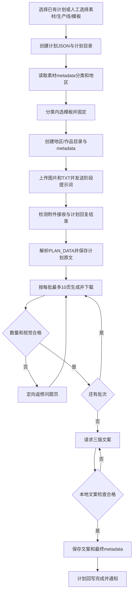

# 内容制作模块加技能设计成技能SOP

日期：2026-10-28
状态：全新设计完善中

本文件同时承担内容制作模块设计方案与内容生产技能 SOP。面板和技能必须调用同一套模块、动作、提示词、状态和结果。旧版流程不纳入本设计。

## 1. 模块总览

内容制作是由多个可组装模块组成的软件：

```text
生产计划
→ 素材选择
→ 生产线选择
→ 模板选择
→ 上传素材
→ 确认计划
→ 分批生图
→ 下载
→ 图片质检
→ 定向返修
→ 文案
→ 文案质检
→ 成品归档
```

A、B、C、D、E 及未来新增槽位都是 GPT 生产线，不绑定固定职责。面板人工操作和内容生产技能调用必须走同一套统一动作接口。

## 2. 数据和目录

### 2.1 素材原数据

每个素材目录只允许一个 `metadata.json`。标签、地区、业务分类、原标题、素材路径和状态都写在这里，不再使用独立 `.tags.json`。

分类读取 `metadata.json`：

- 精准流量/团建方案 → 团建类模板；
- 泛流量/个人攻略 → 个人攻略类模板；
- 互动破冰/小游戏 → 小游戏类模板；
- 缺失或冲突 → 待分类，不随机套模板。

### 2.2 模板库

唯一模板真源：

`D:\AICode\项目推进\projects\江湖有旅人\主项目\02-模板库`

物理分类：

```text
团建类模板/
个人攻略类模板/
小游戏类模板/
上传计划/
```

每套模板包含 `template.json`、P1–PN 实物图、业务分类、本地路径、在线 GPT 链接和 Codex 深链。SHA 只作内部变更核对，不是日常操作门槛。

### 2.3 成品库

```text
成品库/
└─ 计划目录/
   └─ 地区目录/
      └─ 成品目录/
         ├─ P01.png … PNN.png
         ├─ 文案.txt
         └─ metadata.json
```

成品目录只保留图片、文案和原数据。计划原文、计划图片数、模板链接、原素材路径、生产时间、生产线、质检结果和返修记录全部写入 `metadata.json`。

## 3. 生产计划组装器

面板提供四个核心选择区：

1. 生产计划选择：读取本地生产计划 JSON；
2. 素材选择：递归浏览素材库，支持单个作品或多个作品合集；
3. 生产线选择：A、B、C、D、E、F、G 及未来新增；
4. 模板选择：读取本地模板库，本地模板即对应在线 GPT 模板。

模板抽屉升级为大面板，展示编号、分类、P1–PN、业务说明、本地路径、在线 GPT 链接、Codex 链接和可用状态，并支持三类筛选。

### 3.1 方案 A：已有生产计划

```text
选择生产计划 JSON
→ 读取素材路径
→ 读取图片、TXT、metadata.json
→ 读取生产线和模板设置
→ 执行上传模块
```

### 3.2 方案 B：人工组装计划

```text
选择一个或多个素材目录
→ 选择一条或多条生产线
→ 选择一个或多个模板
→ 创建生产计划 JSON
→ 创建计划同名成品库总目录
→ 执行上传模块
```

计划名称由生产线、时间、素材目录/合集名称和模板编号组合生成。

## 4. 上传素材模块

### 4.1 输入

上传模块读取当前计划指定的素材目录，目录包含：图片、一个 TXT、一个 `metadata.json`。

### 4.2 动作

```text
读取计划路径
→ 读取图片和 TXT
→ 将图片 + TXT 上传到当前生产线
→ 创建计划目录/地区目录/成品目录
→ 写入成品 metadata.json
→ 更新计划上传状态
```

元数据文件留在本地，不上传。

### 4.3 阶段提示词

固定提示词文件：

- 模板迁移：`D:\AICode\AI\skills\技能包\技能\content-production\references\template-migration-prompt.txt`
- 确认计划：`D:\AICode\AI\skills\技能包\技能\content-production\references\confirm-plan-prompt.txt`
- 计划提示词：`D:\AICode\AI\skills\技能包\技能\content-production\references\plan-prompt.txt`
- 文案提示词：`D:\AICode\AI\skills\技能包\技能\content-production\references\three-copy-prompt.txt`

提示词通过复制粘贴或输入框注入发送。当前阶段只上传当前需要的图片、TXT 和提示词。

### 4.4 上传完成检测

```text
保存上传意图
→ 注入文件和提示词
→ 等待附件状态
→ 点击发送
→ 读取服务端最新消息
→ 确认图片/TXT已接收
→ 标记上传完成
```

只有服务端确认附件接收后，才进入确认计划；预览、缩略图或点击返回不算完成。未知结果只回读，不重复发送。

## 5. 计划返回与解析

确认计划提示词要求返回完整计划，并附加：

```text
<<<PLAN_DATA>>>
计划名称
模板编号
素材图片数
计划图片总数
生产批次
批次1
批次2
页级计划
<<<PLAN_DATA_END>>>
```

本地直接解析该区块，写入生产计划 JSON 和成品 `metadata.json`。不重复做复杂计划审核。

## 6. 生图、下载和批次

服务端返回计划后，本地读取图片总数：

- 1–10 张：一批；
- 11–20 张：P1–P10、P11–P20；
- 21–30 张：P1–P10、P11–P20、P21–P30。

每批按计划页码发送提示词。上一批完成、下载和数量检查后，自动发送下一批。下载图片直接写入成品目录并更新 `metadata.json`，不使用 SHA 作为操作门槛。

## 7. 图片质检和返修

图片质检是内容制作模块的独立流程，检查：

- 图片数量是否符合当前批次；
- 模板版式和视觉是否符合；
- 文字是否可读；
- 画面是否错主题或有严重缺陷。

不合格时只返修对应页：P3 不合格只重做 P3；P3、P7 不合格只重做两页。返修后重新下载、检查并替换正式图片，旧图移入回收站。返修次数、问题、页码和结果写入 `metadata.json`。

视觉检查可按失败降级链调用：

```text
DeepSeek → MiniMax → Codex
```

## 8. 文案和文案质检

图片全部合格后才进入文案阶段。文案调用 `three-copy-prompt.txt`，固定返回三版：

- 小红书1｜自然攻略版；
- 小红书2｜大纲方案版；
- 抖音｜攻略版。

返回格式固定为 `COPY_FORMAT:MULTI`。复制到本地后，文案检查器检查三版完整性、格式、事实和话题数量。不合格就修改文案，合格后写入 `文案.txt` 和 `metadata.json`。

## 9. 完成条件

只有以下条件全部满足，成品才标记完成：

- 计划图片全部生成并落地；
- 图片质检合格；
- 文案已生成；
- 文案质检合格；
- `metadata.json` 已写入最终状态和修改记录。

缺少图片、文案或质检不合格，保持未完成并继续返修。

## 10. 暂停、恢复和状态回写

生产计划 JSON 和作品 `metadata.json` 同步记录：上传、计划返回、当前批次、下载、图片质检、返修、文案、文案质检、归档、暂停原因和下一步。

面板显示当前计划、当前素材、当前生产线、当前批次、卡点、暂停原因和下一动作。恢复时从最后一个未完成模块继续，不重复已完成步骤。

## 11. 实施细则

### 11.1 模板随机与生产线分配

先读素材 metadata.json 的分类，再与用户所选模板取交集；每套作品只随机一次，选定后保存模板编号，不因暂停或重启重新抽取。多生产线按可用状态领取不同作品，同一作品不重复分配。模板按生产账号查对应在线链接，不能把另一个账号的链接当作本账号可用；没有绑定时显示“需要补充在线模板”，其他可用生产线继续。

### 11.2 目录创建与命名

无论输入来自方案 A 或 B，新计划创建时都创建计划同名空目录。上传一套素材前，在计划目录内创建地区目录和作品目录。作品名为“年月日时分秒_生产线_原标题”；非法路径字符自动替换，重名加短序号。状态只更新 metadata.json 和计划 JSON，不在每个阶段反复重命名文件夹。

### 11.3 作品原数据字段

metadata.json 保存：作品标识、计划名称/路径、地区、业务分类、原标题、原素材路径、标签、生产线、账号、本地模板路径、模板编号、在线模板对话链接、Codex深链、创建/上传/生产/完成时间、GPT计划原文、计划图片数、批次范围、当前步骤、图片完成数、图片检查结果、文案检查结果、返修次数及逐次问题/页码/结果、修改记录、暂停原因和下一动作。

计划 JSON 保存每套素材的同一作品标识、作品目录和当前进度。作品原数据记录详细结果，计划负责汇总展示；每次动作完成同步更新，失败则明确提示待同步，不伪报完成。

### 11.4 视觉服务与返修

DeepSeek → MiniMax → Codex 是服务不可用、不支持图片、超时或无法判断时的后备顺序。判定不合格是正常质检结果，应定向返修，不为得到“合格”而继续换模型。具体模型需要实际验证支持图片后再启用；默认选择可用的普通低成本视觉模型，支持思考强度时使用中等，不支持则不传该参数。

返修记录集中写入 metadata.json。连续没有改善、接口故障或无法继续时暂停该作品，通知用户具体页码和问题；不无限重复发送相同要求。其他独立作品可继续。旧图仅在替换图合格落地后移入系统回收站。

### 11.5 状态裁决与通知

网页生成活动、附件状态、回复结束、下载文件、质检结果共同决定当前步骤；进程存活不代表正在生产。发送结果不明先读取原对话，不重复点击。15分钟没有实际进展触发检查，30分钟仍无进展显示阻塞与原因，不能单凭等待时间判断额度耗尽。

通知是独立模块；完成、需人工处理和连续失败时通知。通知失败只重试通知，不重做图片或文案，也不撤销作品内容已完成状态。

### 11.6 设计与实现状态

### 当前实现门禁补充（2026-10-29）
- `/api/production-workflow/accounts` 只返回经过裁决的阶段、图片计数、附件计数、QA/文案状态；不会暴露私密消息或路径。
- 阶段按钮在缺少计划文本、页级计划或真实回执时保持停用，禁止伪造进入下一阶段。
- 视觉 provider 只读读取本地 secret 可用性，固定 DeepSeek → MiniMax → Codex；密钥不返回、不写入日志。


本文件是待实施的设计合同，不代表面板、脚本、视觉接口、固定计划解析器或文案检查器已经接通。后续实施须逐模块登记实际代码入口、调用方式、输入、输出、状态和真实测试结果。用户要求执行某个模块时调用执行接口；用户要求维护代码时才修改实现。

## 12. 总流程图



## 变更记录

| 日期 | 执行端 | 修改内容 |
|---|---|---|
| 2026-10-28 | Codex | 整份收敛为全新模块设计；清除旧流程冲突；保留计划组装、大面板、单元数据、分批、返修、文案和状态设计；区分设计与已实现能力。 |

## 13. 用户确认的执行细节（2026-10-28）

- 每个生产账号拥有自己的生产计划。同一原料可以同时被不同生产线分别加工，不做跨账号全局去重。每个生产线内仍按各自计划记录作品和进度，不重复提交已完成的同一计划条目。
- 图片和文案每个问题项最多返修3次（不含首次生成）；仍不合格就暂停该作品并通知，继续其他作品。次数和原因写入作品metadata.json。
- 地区或分类缺失时，读取素材原始文案TXT提取并补入同一metadata.json。能够明确提取才填写；不凭空猜测。已有非空字段保留，冲突记录待核。
- 采集系统应在入库时直接写全地区、分类、标签和原标题，避免生产阶段重复分析。存量补齐和采集入口改造分别记录实施状态。

| 日期 | 执行端 | 内容 |
|---|---|---|
| 2026-10-28 | Codex | 按用户答复确认跨账号素材复用、最多3次返修和TXT补元数据规则。 |

## 14. 三类模板与文案会话定标（2026-10-28）

- 团建类：主要复刻封面和内页1。后续内页沿用内页1的排版、布局、字体、颜色与字号，按本轮内容数量规划页数，不为每页额外变化设计。
- 小游戏类：同样采用封面加内页1样式，后续内页按内容数量扩展，保持统一。
- 个人攻略类：参考原模板各页结构有机设计，页数通常接近原模板实际页数；结合本轮内容确定，不机械循环，不将参考页数量直接当成必须产出的数量。
- 三版文案在当前作品生图对话内生成，使用用户指定提示词和团建文案技能规则。不转固定专属文案会话。
- 用户在当前账号的可视化模板面板勾选模板。素材按业务分类匹配对应模板类：团建匹配团建、小游戏匹配小游戏、个人攻略匹配个人攻略；多模板时在勾选且同类的模板中随机。本条不授权跨分类替代；所选集合没有同类模板时的处理另行确认。

| 日期 | 执行端 | 内容 |
|---|---|---|
| 2026-10-28 | Codex | 按用户答复明确三类模板复刻策略、当前对话生成文案及同类模板匹配。 |

## 15. 随机续套与手动恢复

每套完成后，从当前账号被用户勾选的同类模板中重新随机跳转，也允许再次抽中当前模板。各账号只处理自己的计划，不迁移任务。额度或登录问题导致当前未完成作品暂停，保存当前对话、步骤和进度，面板显示原因；用户下次点击继续后检查状态并从断点续接。未上传条目保留原计划不动。

模板入库标准：02-模板库/_规则与台账/模板入库标准.md。分类、标签、完整图片列表与账号链接纳入统一元数据维护；未知信息必须明确标缺失。

## 16. 账号通知群与个人攻略页数（2026-10-28）

每个GPT生产账号绑定独立飞书群；失败通知发送到该账号自己的群。维护时先查已有账号群绑定与真实群列表，复用已有群；确认缺少才创建，避免重复群。群绑定按稳定账号保存，槽位换位不改变通知归属。建群权限或成员信息不足时明确显示未配置，不用公共群冒充独立群。

个人攻略类优先贴近模板原有页数。根据本轮素材组织内容，不为覆盖每张原图强行扩页；计划阶段明确输出页数后按该计划生产。

## 17. 随机、严格质检与评论排序（2026-10-28）

- 模板采用完全随机，允许连续抽中同一个模板，不实行少用优先或轮换限制；范围仍为用户所选且分类匹配的模板。
- 图片严格对齐参考模板的结构、布局、分区、字体、字色、字号和层级。可替换背景场景和本轮文字内容；不得以“能发布”代替模板一致性检查。团建/小游戏后续内页统一使用内页1样式。
- 执行严格遵循生产计划中条目的既定顺序。创建计划时评论数量降序优先；评论数相同时保留原选择顺序，缺少评论数排在已知评论数之后并标未知，不假装为0。读取已有计划、暂停恢复不得重新随机或按路径字母重排。
- 代码核查发现：src/server/routes/production-plan.js 的选择列表规范化使用sort()，会将素材路径按字母排序；须区分来源顺序与模板集合规范化。该接口同时依赖规范化结果计算计划编号，修改须同步处理读取校验，不能直接删除sort导致已有计划不可读。
- 发现realtime-production-plan.js含固定演示健康状态和示例成功日志，新设计须移除演示结果，未采集真实状态时显示未知，不冒充生产和模板同步成功。

| 日期 | 执行端 | 修改 |
|---|---|---|
|2026-10-28|Codex|确认完全随机、严格模板视觉一致和评论优先；记录排序与演示状态实现缺陷。|

## 2026-10-28 计划顺序与健康状态修复

新建计划保留传入素材顺序，不按路径重排；旧计划编号读取不受影响。移除实时计划接口固定成功日志，未取得状态时显示UNKNOWN。计划路由7/7测试通过，实时路由语法检查通过。源码已改，运行实例尚未加载；评论数优先的计划生成端仍需核对。


## 18. 主动暂停、计划编辑与恢复（2026-10-28）

- 用户点击暂停：立即禁止该生产线后续发送，并向当前GPT页面发起停止生成操作；保留已生成内容、已下载图片和当前步骤。不关闭页面、不删除任务；网页停止尚未确认时显示“暂停请求已发，网页停止待确认”，不能假报已停止。
- 没有用户暂停、额度或具体故障时，不因普通生成等待自动停止网页。生成耗时和无响应由状态检测区分。
- 计划可实时更新，新增素材默认追加到尾部，不重排已完成或当前执行条目。
- 用户明确要求插队时，将新条目插到当前作品之后、下一条待执行作品之前。当前作品不受打断，已完成条目不改变。执行器在领取下一条前重新读取计划；编辑和领取需要同一后端串行保存，防止刚插队又被旧快照覆盖。条目使用稳定标识，位置变化不丢状态。
- 点击继续：先读取网页现有生成结果和本地成品文件。已有图片尚未下载则优先下载；本地已存在且可读取则继续缺失步骤。不得直接重发整批。部分生成时只补未完成页；无法判断是否仍在生成时先检测原页面，显示当前状态。

|日期|执行端|内容|
|---|---|---|
|2026-10-28|Codex|记录用户主动暂停网页、尾部追加/当前后插队、恢复优先找回下载规则；具体功能仍待实现验证。|

## 19. 计划可视化编辑与缺页补齐（2026-10-28）

- 计划JSON中的素材路径指向本地素材库。面板提供拖动排序、删除、追加和插队操作；保存后下一次领取任务读取最新计划。
- 已完成条目默认保留并跳过，不再重复执行；用户也可从计划中移除已完成条目，不影响其他条目。移除记录不等于删除源素材或成品。
- 当前批次应生成10页但只生成7页且已经停止时，保存已有图片，按实际缺失页继续补齐。例如已确认P1–P7，下一次要求补P8–P10；第一批齐全后再进入下一批。不能整批重做或把已生成图片误算成下一批。若缺页不连续则列出准确缺页，不仅按图片总数推断页码。
- GPT未返回PLAN_DATA或字段不明确时，在原对话要求仅补齐本轮固定计划区块，保留已有计划内容，不重新上传素材，不猜页数。补齐成功再进入生图；失败显示计划格式待修复。

|日期|执行端|内容|
|---|---|---|
|2026-10-28|Codex|确认计划可视化编辑、已完成记录可移除、缺页续补及固定计划格式补齐。|

## 20. 删除与提示词生效边界（2026-10-28）

- 删除仅移除生产计划条目，绝不删除原素材、已有图片或完整成品。
- 当前正在生产的条目禁止删除：前端禁用删除按钮，后端也拒绝删除，避免只靠按钮限制。删除其他未开始/已完成条目不干预当前网页生成。
- 每个阶段在发送前读取对应本地提示词最新版；尚未到达该阶段的任务使用最新内容。已发送或已完成的阶段不因文件更新重新执行，避免重复提交。该次实际发送内容保存在应用任务记录中供定位问题，不另塞进成品目录。

|日期|执行端|内容|
|---|---|---|
|2026-10-28|Codex|确认删除仅影响计划、在制条目禁删、提示词按阶段发送时读取。|

## 21. 独立产线、关闭选项和多候选（2026-10-28）

- 所有生产线独立执行各自计划，切换查看另一生产线不暂停任何正在运行的任务。
- 用户关闭内容制作窗口或请求退出时弹出三个选项：最小化窗口；隐藏到后台继续运行；彻底退出。后台继续是默认保留生产能力的路径，不因前端隐藏中断任务；彻底退出则暂停全部任务、保存进度并退出。
- 后台运行目标为24小时无人值守，允许用户手动终止。需要持久任务宿主、有效GPT页面/CDP连接、登录和主机网络；不把隐藏窗口等同销毁GPT网页。即使没有可见前端，后台仍须能检测回复、下载并更新状态。后台能力必须实际验证，不能仅靠设计宣称已实现。
- 当前回复若确认为同一页的两个候选，可任选一个继续并记录选择；候选交互识别作为后续升级事项，不把所有图片候选误认作新增计划页。
- 确实超出计划的独立成品页应向GPT说明超过计划，要求回到既定页数和页码，不擅自扩大计划或重做已合格图片。无法确认候选/独立页时显示待识别，不仅按缩略图数量判错。

|日期|执行端|内容|
|---|---|---|
|2026-10-28|Codex|确认产线独立、关闭三选项、持续后台生产目标及超计划/候选处理。|

## 22. 冷却、开机恢复和通知定标（2026-10-28）

- 平台明确触限后，停止该账号对应受限阶段的尝试，保存原始限制提示和恢复时间。恢复时间后一次性随机增加10–20分钟缓冲，保存实际下次尝试时刻；不得每次巡检重新抽样导致无限后延。到点检查原任务并尝试续接，仍受限则按最新提示更新。用户手动暂停不被自动恢复覆盖。本条覆盖第15节“所有额度暂停均等用户继续”的旧表述。
- Windows登录后默认开机自启，显示前端，检查网络及必要服务后恢复此前运行中的计划；手动暂停/彻底退出保存的暂停计划保持暂停。设置提供可关闭的开机自启开关，以及启动后自动恢复计划开关，默认开启。安装自启和实际重启恢复尚待实现验收。
- 各账号独立飞书群只发送整套完成、明确额度触限、需要人工处理的事项。普通进度不发送；相同事件去重，恢复或状态明显变化才更新。
- 候选排产模式：每小时一套，在每个整点前10分钟至后10分钟之间随机安排一次，具体按账号还是全局、套数代表上传出计划还是完整制作，待下一轮确认，暂不改变现有执行频率。

|日期|执行端|内容|
|---|---|---|
|2026-10-28|Codex|确认冷却缓冲自动续接、默认开机恢复与三类通知；小时节奏列待确认。|

## 23. 每账号小时完整生产调度（2026-10-28）

- 每个生产账号独立每小时启动一套，在整点前10分钟到后10分钟区间随机安排，时间抽定后保存，不因刷新重抽。用户本轮“每10小时”按上下文记为口误，沿用反复确认的每小时。
- 每套包含上传素材、获取计划、确认计划、分批生图、下载、图片质检/返修、三版文案/检查和落地。模板同步/对齐属于独立基础模块，不包含在小时制作流程中。
- 正常预期耗时为几分钟至20分钟，此为用户经验，不是强制生成截止时间。一套超过60分钟仍未完成，标异常并通知该账号飞书群；保留原窗口、结果、任务状态，不关闭或删除。
- 超60分钟旧作品不再占住下一套排产：跳过该条，打开新的工作窗口与选中模板，执行下一套素材。旧作品后续结果如何收回、是否继续完成需按异常恢复规则明确；检测与页面写入按具体对话区分，不让新旧作品串线。
- 账号明确受额度限制、登录失效或用户主动暂停时，不用新窗口绕开限制；此时继续遵循冷却/人工恢复规则。

|日期|执行端|内容|
|---|---|---|
|2026-10-28|Codex|确认每账号每小时完整流程、模板同步独立和超一小时保留旧任务另起下一套。|

## 24. 异常交人工与立即启动（2026-10-28）

- 单套超过60分钟未完成，标记异常，在对应账号飞书群发送作品、阶段、耗时和准确GPT对话链接。随后该作品交给用户人工处理，自动流程不再下载、质检、获取文案或跟进迟到结果，保持未完成/异常状态。
- 后续新的小时任务可继续；每套再次出现异常都独立通知，不因累计异常数自动停止账号。额度、登录或用户暂停仍遵守独立阻塞规则。
- 点击开始/继续时立即执行可续接任务；该次实际启动占用一个小时档位，避免临近整点重复开套。用户示例：21:38立即开工计入22点档，下一套为23点前后10分钟随机时刻。准确半小时分界由下一轮确认，不先假定所有边界。

|日期|执行端|内容|
|---|---|---|
|2026-10-28|Codex|确认超时作品交人工后不再自动跟进、每次异常独立通知及21:38占22点档示例。|

## 25. 首次计档与异常人工状态（2026-10-28）

- 首次点击开始立即执行，按最近整点归档：21:00–21:29属于21点档；21:30–22:29属于22点档。此分界仅用于立即启动占档，不改变后续整点前后10分钟随机调度。
- 暂停后再次点击开始优先续接未完成任务，不重复创建当前作品。面板另提供显式“额外做一套”操作。
- 超时作品通知后标记“异常已交人工处理”，自动执行器不再跟进该作品，不要求人工处理后回填完成，也不因用户在原网页手动操作干预其他任务。
- 用户最新指出超时后不要立即跳过并开始下一任务；是否仍在下个小时正常启动下一套，下一轮单独确认。在确认前不实施新的超时自动启动逻辑。

|日期|执行端|内容|
|---|---|---|
|2026-10-28|Codex|确认首次最近整点计档、继续优先恢复和人工交接状态；超时后下一小时行为待澄清。|

## 26. 最新异常暂停裁决（2026-10-28，覆盖第23–25节冲突项）

- 单作品超过60分钟未完成：标异常已交人工处理，暂停所属生产线并发送群通知和对话链接；不自动启动下一套。其他生产线继续。
- 异常检测需区分网络不可达、网页离线/错误、登录失效、明确额度限制、正常生成等待和执行器故障；界面显示真实检测结果和最后变化时间，不仅凭耗时猜根因。检测机制属于待实现/验收能力，未接通不得宣称已具备。
- “额外做一套”不改变正常小时排产。例如21:31开始占22点档，完成后可额外做一套，后续23点档不变。同账号任务重叠时如何处理待明确，不静默覆盖当前任务。
- 普通切换查看和执行“开始/继续”是两个不同动作，查看不暂停产线。执行动作若命中正在生成的同一对话，按用户最新要求停止该执行并通知；究竟只阻止重复启动还是同时点击网页停止生成，下一轮确认后实施，避免误停正常任务。

|日期|执行端|内容|
|---|---|---|
|2026-10-28|Codex|按最终答复确定超时暂停单线、额外套不改调度及重复启动待细化。|

## 27. 重复启动卡片、排产抵扣与断网恢复（2026-10-28，覆盖冲突旧条款）

### 重复开始

当前账号已有任务时弹出“当前已有任务正在进行，请等待完成”，展示作品、阶段、已用时间和打开原网页入口。提供“继续等待”（默认，只关闭卡片）与“停止本产线自动流程”两个选项。后者仅停止该账号后续自动操作并保存断点，不默认点击网页停止生成，也不影响其他账号；与用户明确点击主暂停按钮要求网页一起暂停的操作区分。停止结果必须可见。

### 额外套占档

额外套未完成而正常排产时间到达时，不同时启动另一套。当前额外套计入该正常档位，该小时不再补开，之后继续原时间表。没有跨过正常排产点的额外套不改变正常时间表。

### 网络恢复

短暂断网首先最多尝试重连3次，避免紧密无限重试；之后在原断线时刻+10分钟、+30分钟、+60分钟各尝试一次，总计最多6次。复查时间持久保存，不因面板刷新重新起算。重连仅恢复连接和读取原任务，不自动重发上传/生图请求；有活动生成时不刷新或销毁页面。

每次尝试向账号独立群报告恢复尝试及结果；前3次可合并为一条阶段更新，后续各复查点更新一次，避免同一尝试重复通知。恢复成功即取消剩余复查并从原断点续接。6次失败后保持该生产线网络阻塞，通知需人工处理，不无限重试。用户主动暂停或退出后不得因网络恢复重新启用任务。

|日期|执行端|内容|
|---|---|---|
|2026-10-28|Codex|确认重复开始卡片、额外套跨档抵扣及3次即时加10/30/60分钟恢复设计。|

## 28. 单线折叠面板与模板列表（2026-10-28）

- 每个生产账号有独立面板及独立选择状态，切换产线不共用计划/模板选择。生产面板可展开、折叠，保持GPT主网页视图可用，不强制三栏把网页塞到右侧。
- 日常生产面板选择已有计划和模板，中央展示当前一套作品的步骤进度；素材已由计划路径给出，不重复要求日常选素材。
- “创建计划”为单独入口，可选择素材及模板并生成计划，随后返回日常生产面板。详细面板需展示任务与步骤，但折叠后不遮挡网页。
- 每账号同时选择一个计划；同一份计划被一个账号选中后，其他账号不能再选中。不同计划可以包含同一原素材，不影响跨账号独立加工。占用释放、暂停与更换计划规则待后续确认。
- 模板选择使用大面板列表，一行一个模板，展示名称、分类、勾选框及P1–PN小预览图。提供“进入预览”入口；点击缩略图不默认弹大图或改变选择，预览和勾选独立。按三类筛选，保留已勾选状态。
- 图片验收允许轻微像素和行距误差；整体结构、布局、分区、字体、字号与字色须一致，明显偏差返修。不能追求像素逐点相等，也不能仅以可发布放宽模板一致要求。

|日期|执行端|内容|
|---|---|---|
|2026-10-28|Codex|确认独立可折叠面板、独立创建计划入口、计划单账号占用、模板列表预览与视觉容差。|

## 29. 计划锁定、更换与完成（2026-10-28）

- 计划被账号使用后保持绑定锁定；暂停、重启、切换计划或计划完成不自动释放。只有用户显式清除绑定后，其他账号才可选择接手。覆盖第28节对完成后释放的待确认表述。
- 账号允许更换未完成计划。旧计划保留每条素材阶段与断点、已生成内容和绑定，不标作完成；如当前有在途操作，先明确暂停/保存再切换自动执行目标，不把新计划注入旧作品对话。
- 同一账号同一时刻只有一个活动计划，但可以保留多个历史绑定计划供重新选择续接。更换计划不重置旧计划完成条目。
- 计划全部完成后向该账号群通知一次，停止该计划调度并等待用户；不循环，不自动寻找其他计划。已完成作品和计划状态保持可查询。

|日期|执行端|内容|
|---|---|---|
|2026-10-28|Codex|确认用后持久锁定、显式清除才跨账号接手、未完成可换计划与完成仅通知等待。|

## 30. 跨账号续接、当前换模板和简洁列表（2026-10-28）

- 用户清除绑定并把计划交给另一账号时，新账号续接计划，已完成条目跳过，未完成条目保留已有进度。跨账号网页对话访问不是默认成立，具体如何转移未完成阶段下一轮确认，不擅自把“续接”实现为整套重做。
- 用户可为当前作品重新选择模板，选择立即保存生效，覆盖“整套期间禁止换模板”的旧限制。已发送请求与已生成图片不因本地字段修改自动变化；是否停止旧生成及重做哪些页需在交互中明确，不静默混用新旧模板。
- 计划列表优先只显示原素材文件夹名称与进度；其他信息、剩余任务及原网页/成品入口通过点击详情打开，不堆满默认列表。

|日期|执行端|内容|
|---|---|---|
|2026-10-28|Codex|确认解绑后计划续接、当前可换模板与简洁列表；跨账号和在途换模板执行细节待明确。|

## 31. 跨账号与换模板重做规则（2026-10-28）

- 计划解绑转给另一账号时，只续接计划进度，不打开原账号对话，不继续跟进原账号未完成那一波。已完成条目跳过；未完成当前作品在新账号按完整作品重新生成，不拼接两账号各一半的图片。旧文件不自动删除，旧尝试不再自动驱动。
- 当前作品已有部分图片而用户更换模板时，按新模板整套重新生成，不把旧模板页和新模板页混成一套。已生成旧结果不当成新版本完成数，保持可恢复直到新版本合格替换。
- 计划列表保留原文件夹名称、进度，不增加点击条目打开网页/成品的默认入口；此前提议入口取消。

|日期|执行端|内容|
|---|---|---|
|2026-10-28|Codex|确认跨账号只续计划、未完成作品重做、换模板整套重做、取消列表默认打开入口。|

## 32. 重做清理、文字返修和失效素材（2026-10-28）

- 整套重做沿用同一个作品目录，保留metadata.json中的修改次数、失败原因和生产记录；旧生成图片永久删除，不保留旧版本，也不留回收站副本。只针对本作品已登记的生成文件，不能清空整个目录或系统回收站，更不能删除原素材。此为后续实现规则，本次仅更新设计未执行删除。
- 图片错别字由GPT按指定页重新生成，不用本地绘图或排版工具改字。其余合格页不重做；返修仍受最多3次规则约束，结果写回metadata。
- 原素材目录或必需图片/TXT移动、删除造成不可读时，标记该条素材路径失效并通知账号群，跳过该条继续其他素材；不因一条失效暂停整条生产线，不把跳过标成完成。

|日期|执行端|内容|
|---|---|---|
|2026-10-28|Codex|确认同目录重做永久清旧生成图、GPT定向纠字及失效素材通知后跳过。|

## 33. 整套重做、评论来源与失效条目终态（2026-10-28）

- 整套重做时，旧文案同时作废；新图片全部合格后重新生成三版文案并检查，不沿用旧稿。
- 建计划的评论数直接解析原素材文件夹名称前部的“评N”等既有格式，取数值降序；无法解析时按0参与排序。覆盖前文缺失评论数视为未知并排末的规则。评论排序只作用于创建/明确重新排序，执行已保存计划仍按其顺序。
- 路径失效并跳过的条目保持跳过，不自动复查、不自动重排，也不要求加入单条重试功能。用户修复后如需制作，另行创建新计划。

|日期|执行端|内容|
|---|---|---|
|2026-10-28|Codex|确认整套重做包含文案、目录名前缀评论数缺省0及失效条目不再跟进。|

## 34. 次级排序、计划完成汇总与失败对照（2026-10-28）

- 创建计划按文件夹名称中的评论数降序，再按点赞数降序；两者均相同则稳定保留原选择顺序。缺少可解析数值按0。
- 全部条目处理结束后计划标记完成，不因路径失效或已终止失败条目永久保持进行中。计划完成不等于每套作品合格，逐条原状态保留。
- 完成通知汇总计划名称、成功数量、路径失效数量；若实际存在质检失败、超时交人工等情况，同样如实列出数量，不按“应该没有失败”隐去事实。计划汇总只发送一次，普通进度静默。
- 质检失败通知包含作品名、原素材路径、成品路径、具体页码和原因、准确GPT对话链接；附对应原素材图和失败图供用户对照，明确各图身份。路径和图片都须来自本条真实作品，不能用其他作品图片替代。

|日期|执行端|内容|
|---|---|---|
|2026-10-28|Codex|确认评论后点赞排序、计划处理结束即完成汇总、失败路径与图像对照通知。|

## 35. 完成通知与计划内去重（2026-10-28）

- 每套完成通知仅发简短文字，不附封面；包含作品名、该生产线实际在线模板链接、原素材本地路径、本地模板路径及成品路径。链接和路径对应当前实际作品，不用其他账号链接替代。
- 默认全天24小时按各账号小时节奏运行，仍遵守用户暂停、额度冷却、异常与登录阻塞状态。
- 创建计划递归展开素材目录后，按规范化绝对素材路径去重，同一路径在同一计划只保留一条；不同计划和不同账号仍允许分别加工。不同目录不因标题相似就自动合并。

|日期|执行端|内容|
|---|---|---|
|2026-10-28|Codex|确认简短完成通知五项字段、全天运行和计划内路径去重。|

## 36. 模板创建与本地权威命名（2026-10-28，覆盖前文生产不补模板限制）

- 保留独立“同步模板”模块，用户随时可点击为选定账号创建模板对话。
- 按用户后续明确补充：生产选择的模板缺该账号在线绑定时，可调用同一个模板创建模块补齐，再继续作品，不建立第二套创建逻辑。不得因旧链接当前不可读就直接新建，先确认是确实缺链接还是登录/网络故障，避免重复。
- 固定创建流程：在目标账号新对话上传本地模板P1–PN及完整模板迁移器提示词；发送“等我上传”，取得明确已学习模板、等待本轮素材的回复；把在线对话名称改为本地模板名称；保存该账号对应对话链接到本地template.json及注册表，再继续上传素材。
- 本地模板名为权威，在线改名不反写本地名称。检测到在线名偏离时将在线名称改回本地名；新建或替换对话的链接仍须回写本地账号绑定。
- 模板上传、等待学习、重命名、写链接各自显示状态，失败保存当前步骤，不把缺链接与平台触限混为一谈。

|日期|执行端|内容|
|---|---|---|
|2026-10-28|Codex|确认独立同步及生产缺模板自动调用同流程、本地名称权威与账号链接回写。|

## 37. 学习完成与同名对话核验（2026-10-28）

- 模板学习完成要求GPT明确确认，并简述模板封面/内页布局；无需生成测试图，不增加测试生图成本。学习说明保存到模板元数据。
- 发现在线同名对话而本地无链接时，核对真实对话里的参考图及模板学习内容。确认匹配就补回当前账号链接，不重复创建。
- 用户授权删除确认不匹配的那个同名模板对话并重新创建。删除必须锁定准确账号与对话，不能只凭名称相同或读取失败判不匹配；网络/登录导致不可读时不删除。存在当前生产任务的对话不在普通同步中直接删除，先报告冲突。
- 本地名称更改后，在下次用户点击同步模板时将在线名称改为当前本地名；不要求本地改名时立即遍历所有账号。

|日期|执行端|内容|
|---|---|---|
|2026-10-28|Codex|确认学习简述、正确同名对话复用、错配精确删除重建及下次同步改名。|

## 38. 全量同步与失败处理（2026-10-28）

- 点击同步模板默认核对当前账号全部本地模板：核对本地/在线对应、当前名称、现有链接与新增缺项，不是每次全部重新上传。
- 单模板同步失败保存原因并通知；其他模板可继续。先排查，只有明确失败且准确归属该次创建的对话/记录才清理重建；未知发送、网络不可读不能直接视为失败删掉。
- 用户要求连续失败两次暂停同步并通知人工。此“两次”指同一模板的两次尝试还是连续两个模板，下一轮确认；未确认前不实施自动删除/重建循环。
- 本地模板图片内容更新不自动触发在线重新学习或新建对话，不增加主动图片变更同步流程。同步范围仍是新增和绑定/命名对齐；用户明确要求重学时再执行对应模块。

|日期|执行端|内容|
|---|---|---|
|2026-10-28|Codex|确认当前账号全量核对、失败记录通知与两次暂停、本地图更新不主动重学。|

## 39. 模板同步暂停门与汇总（2026-10-28）

- 同一个模板首次失败、清理后重新创建仍失败，总共两次失败，即暂停当前账号模板同步并通知，不继续自动重建。不同模板不合并为这个计数。
- 账号正在生产时，点击同步只提示“当前账号正在生产，如需同步请暂停生产”，不偷偷暂停、不自动排队。用户先暂停计划后才能执行同步；若网页生成仍活动则显示等待停止确认，不抢同一账号页面。
- 同步结束发一条简要汇总：本地模板总数、该账号在线模板数量、已对齐情况、失败模板及是否重试。在线数量指可核实的对应模板对话，不把其他普通对话或旧本地记录冒充已核在线数。
- 对齐问答改为每轮至少10题，按同一主题集中，不再拆成每轮3题。

|日期|执行端|内容|
|---|---|---|
|2026-10-28|Codex|确认同模板两次失败暂停、同步须先手动暂停生产及三项汇总。|

## 40. 全量一对一同步与账号管理（2026-10-28，最新定标）

- 同步是独立功能，覆盖当前账号对应的全部三类本地模板，与当前计划是否使用无关。本地为权威，在线一对一对齐。
- 在线模板对话统一放在各账号的GPT“模板库”项目；不存在则创建。
- 同账号两个确认正确的同名模板对话只保留一个，删除多余那个；在线模板库项目中确认对应本地已不存在的模板对话删除。必须精确定位模板对话，不能把普通生产对话、网络不可读或未经核实的项当多余删除。
- 本地缺图模板通知并标待处理，继续其他模板；不伪造模板图片。
- 按本地模板编号顺序同步。单模板失败立即重试一次，仍失败记录并处理其他模板；连续两个不同模板均失败则暂停同步并通知。成功一个模板后清除连续模板失败计数。本条覆盖第39节“单模板两次失败就停全部”的旧规则。
- 中途暂停后继续未完成模板，已完成项不重复创建；同步结束不改变原生产暂停/运行设置。
- 每条生产线独立面板，可显示字母与昵称但不是必需；作品metadata必须记录真实产线、账号及对话链接。
- 新增账号先登录，再绑定独立飞书群；账号面板设置提供群ID配置，AI可调用同一配置能力维护。
- 移除账号只移除账号面板配置，不删除通用本地计划、成品或在线对话。原计划账号绑定解除方式须明确显示，不静默删除计划。
- 交互设计优先使用可选答案，一轮20题集中对齐；确认内容即时更新本文件，不将设计更新声称为生产代码已经生效。

|日期|执行端|内容|
|---|---|---|
|2026-10-28|Codex|登记用户12项同步与账号规则；替换失败计数旧口径，明确当前设计与源码改动边界。|

## 41. 面板与运行设置二十项定标（2026-10-28）

1. 开始执行选定完整制作流程。自动模式为全天每小时一套；关闭自动模式后，手动点击开始仍逐套连续运行，每套完成并落地后等待1分钟再做下一套，直到计划结束或暂停。不是每套都必须人工点击。
2. 用户选择大流程，后台自动按规范依赖组装小模块，不要求用户手工搭后端步骤。流程及模块采用统一命名、输入输出规范，支持以后按口述扩展组合。
3. 每条生产线记住面板展开/折叠状态，首次默认展开。
4. 选择计划右侧提供创建计划按钮。创建计划采用独立弹窗承载详细素材选择、关键词搜索、先筛选再搜索与AI综合要求输入；日常生产面板仍主要选计划和模板。AI要求由后端转换为筛选条件，实际生成计划仍共用同一能力。
5. 勾选合集递归展开为素材作品，按路径去重。支持地区、分类、季节、关键词、评论等筛选；具体字段定义继续确认。
6. 计划自动命名，可手动改名；过长时缩短显示/目录名称，完整名称保存在元数据。不单独增加创建前排序预览确认页，按排序直接保存。
7. 选择计划后默认自动勾选计划素材所属类别的全部适用模板，再逐套按类别随机；用户可关闭自动勾选，手动选择。切换模板类别筛选不清除其他类别选择。
8. 进入预览打开独立可关闭弹窗，展示大图并左右翻P1–PN；关闭回原面板，不改变勾选。
9. 单线面板显示下次生产时间、当前阶段、剩余作品数量和进度。
10. 群ID缺失不阻塞生产，在通知步骤用电脑通知兜底并显示未配置。飞书发送失败独立重试，不改变作品完成状态或阻塞下一套；重试失败用电脑通知提示。
11. 移除账号保留计划及进度，并解除其计划绑定，其他账号可接手；成品和在线对话不删除。正在生产的账号禁止移除，提示先暂停。
12. 群ID变更以用户最后表述为准：旧已发起通知保留原目标群，新产生通知使用新群；待处理发送只作内部状态，不向用户堆砌术语。具体重试次数后续确认。
13. 每条产线提供恢复默认设置按钮，重置范围和运行时行为下一轮确认，不能静默删除账号或作品。

|日期|执行端|内容|
|---|---|---|
|2026-10-28|Codex|汇总本轮20项答复，确认自动小时/手动连续模式、计划弹窗、模板自动选择、电脑通知兜底和账号移除解绑。|

## 42. 搜索建计划与单线设置定标（2026-10-28）

- 初始默认手动连续模式，按计划逐套完成至触限、暂停或计划结束。每套完整落地后随机等待，设置用秒数配置最小/最大间隔，初始60–120秒。自动每小时模式可手动开启；运行中允许切换，当前在途步骤不因切换重复发送，精确下一套调度边界待确认。
- 恢复默认仅作用于当前账号面板的运行和界面参数，模式恢复手动、等待恢复默认，账号登录保持；正在生产禁止恢复默认，提示先暂停。群ID和计划绑定不作为普通运行参数静默删除。
- 搜索匹配文件夹名称及原文TXT；提供关键词“全部满足/任意满足”开关。输入每个字及筛选变化自动更新结果；实现需索引与短防抖，不每个按键重扫全库，迟到请求不覆盖新结果。
- 季节筛选按当前素材库季节文件夹，元数据不是本筛选必需门槛。评论数默认降序、同评论点赞降序，评论范围是否另设暂未确认，不额外增加必填项。
- 作品数上限可设置，默认不限。搜索结果默认只展示完整原文件夹名称和勾选框，不重复拆列展示评论点赞，不默认封面预览。
- AI筛选通过本地MiniMax接入，用户输入要求后显示筛选结果，并对照要求询问是否创建；AI对话调用也使用同一建计划能力。解析失败显示错误并保留输入，用户可用普通关键词筛选，不擅自降级创建计划。
- 多地区勾选默认并集；支持包含/不包含等筛选能力，交集与排除不是同义词，后续界面须分开表达。
- 未选素材点击创建提示“没有选中素材”，不生成空计划或空目录。创建计划无需指定生产账号，保存后再由生产线选用。
- 计划自动命名、允许手动修改；重名时弹出自动加序号重命名、覆盖原计划、手动修改三个选项。覆盖已有进度的细节另行确认，不直接覆盖运行计划。
- 飞书失败最多重试2次，间隔30秒、2分钟；仍失败电脑通知，不阻塞生产。电脑通知支持点击打开对应生产线，不能因点击自动开始或暂停。

|日期|执行端|内容|
|---|---|---|
|2026-10-28|Codex|登记20项答复：默认手动、随机秒数、实时搜索、MiniMax筛选确认、无账号建计划、重名三选项及通知重试。|

## 43. 筛选与模式切换最终细节（2026-10-28）

- 多关键词默认任意满足，不区分大小写；提供全部满足切换。搜索范围可选文件夹名称、TXT正文或两者，不增加排除关键词框。
- 地区多选为并集，支持排除地区，不设必须多地同时出现。筛选变化保留隐藏的勾选，显示已选数与清空入口。全选只选当前页，不静默选择所有分页。
- 可选作品数上限默认不限，无固定100条硬限制；用户设置N时从筛选结果按评论/点赞排序取前N条。与已有手动勾选的冲突还需明确交互，不能静默加入未授权条目。
- 无TXT的素材在结果中标注缺失并禁止选入。多季节镜像优先按相同笔记ID合并；无ID时再按路径去重，覆盖此前严格仅路径口径。不同内容更新版的同ID冲突需另行明确，不按标题猜。
- AI只帮助填写筛选条件，结果允许用户继续普通筛选调整；零结果保留条件、提示零结果，不创建计划。
- 覆盖同名计划视为新计划，重置进度，覆盖前再次确认；运行中禁止覆盖，提示先暂停或另存新计划。覆盖计划不授权删除已有成品。
- 手动连续切自动小时，当前作品计入最近整点档，后续等下一档随机时间。自动小时切手动连续，当前作品结束后等待用户再点击开始，不自动连续。
- 随机等待倒计时提供立即下一套按钮，取消本次等待；最小间隔大于最大值时提示无效并拒绝保存。
- 手动模式触限后保持暂停，必须用户再点开始；自动模式仍按平台恢复时间加10–20分钟检查续接。用户主动暂停始终优先。
- 计划是JSON，允许改显示名/文件名并更新选择引用；已创建且仍为空的计划成品总目录同步改名。有产物目录的改名范围待确认，不擅自搬迁。

|日期|执行端|内容|
|---|---|---|
|2026-10-28|Codex|登记本轮20项选择；区分模式冷却恢复、笔记ID去重、实时筛选和覆盖进度重置。|

## 44. 计划、下载与验收二十项定标（2026-10-29）

- 计划页码和总数正确即可进入后续；每页不强制有标题，允许纯画面页，不能将无标题误判缺失。正文数量与固定区块冲突时要求GPT统一重返区块，最多补3次，仍失败通知并暂停该作品。
- 计划正常返回后写入作品metadata并自动确认生图，不逐套要求人工确认。
- 图片默认3:4竖图、网页原生高质量原图，不强制精确像素。文件名按P1、P2顺序，可使用P1-封面、P2-内页1、P3-内页2，保留真实图片格式扩展名。
- 图片已生成但下载失败只尝试下载，共2次，仍失败暂停该作品并通知。数量不足先找网页未加载原图，再确定真实缺页补生成，不仅凭已下载数量判断。
- 视觉输入为成品图、对应模板图和当前页计划；核内容需要时增加原素材图。每批集中检查后收集失败页统一定向返修。
- 背景可以变化，布局、分区、字体、字色、字号保持模板一致，轻微像素/行距差异接受。价格不能编造；活动和画面可创意补充，不能将缺原图证据的活动一律判废。活动表达边界后续细化。
- 单页最多返修3次仍失败，保留其他合格图片，整套标未完成并通知，不发完成通知；所有视觉API不可用时保留下载结果、暂停质检并通知，不能默认通过。
- 面板显示问题页码、原因、返修次数；提供人工通过，记录备注后继续文案。
- 图齐合格后在当前对话发送固定文案提示，要求读取本轮已上传TXT并调用用户指定开源文案技能；默认不重新上传已生成图片，只有发现对话无法识别当前结果才处理具体缺项。
- 文案修3次仍不合格标记并通知，继续下一套。正式不合格文案如何落盘待定，不把失败标完成。

|日期|执行端|内容|
|---|---|---|
|2026-10-29|Codex|登记本轮20项：纯画面页、自动确认、下载两次、批量视觉返修、活动创意、人工通过和文案失败继续。|

文案能力公开入口（本地技能登记确认，尚未本轮联网验证）：https://github.com/zwmopen/skills-public/tree/main/skills/teambuilding-copywriter 。调用方需取得实际规则内容再发送，不能仅附链接就宣称网页GPT已读取。用户当前“本作品对话生成文案”优先于旧技能的专属会话路由。当前共享技能默认第二版为“高密度种草版”，与设计旧“大纲方案版”名称冲突，下一轮确认。

## 45. 文案与实施优先级定标（2026-10-29）

- 三版文案第二版正式名称为“小红书2｜高密度种草版”，具体字数、标题和话题规则唯一读取本地共享文案技能；内容制作模块不复制维护第二套规则。公开技能地址：https://github.com/zwmopen/skills-public/tree/main/skills/teambuilding-copywriter 。GPT无法获取时提醒用户人工处理，不伪造调用成功。
- 文案过滤原作者联系方式和旧账号引导；默认不编造亲历。无价格时可写“费用按人数和活动安排确认”，不写数字。创意活动写成可安排玩法，不写场地自带/已包含；文案基于本轮原图和TXT，不能另写一套与素材不一致的活动。
- 图片命名默认P1-封面、P2-内页1、P3-内页2；下载失败两次标记该作品失败并通知，继续其他作品。计划格式补齐三次仍失败标记异常并通知，继续其他作品。
- 视觉服务不可用时重试2次，仍失败暂停该生产线并通知；恢复后按用户点击继续或自动模式规则续接。人工通过可不填备注，记录时间；图片数量仍必须完整。
- 文案只提取固定COPY_FORMAT区块，代码块外说明丢弃；只做确定性空行/换行格式清理，内容问题回GPT修改。文案始终不合格时保留图片和metadata，不写正式文案.txt，状态未完成。
- 默认模型按配置使用，不在质检或格式修正中自动升级更贵模型。实施先做单一账号一套完整真实闭环，再扩展多账号与完整面板。
- 素材季节筛选只影响搜索入选；文案取本轮TXT主要事实，不因筛选季节强行改写原内容。

|日期|执行端|内容|
|---|---|---|
|2026-10-29|Codex|登记文案规则、视觉失败暂停、单账号闭环优先及内容过滤边界。|

## 46. 第一套真实闭环验收定标（2026-10-29）

- 首轮采用A/B对比：A已有在线模板，B/C当前缺模板，B/C先执行模板同步模块；真实闭环使用真实GPT、真实素材、真实图片额度，手动模式，不做空探测。
- 测试素材取现有计划中评论数最高且metadata完整的一条；模板在该素材分类的已绑定模板中随机选择。若缺账号模板链接，调用模板同步模块创建，不换类别模板冒充绑定。
- 单套完整验收必须同时满足：计划图片数量、严格模板视觉质检、三版文案、metadata字段和计划/地区/作品三层目录全部完成，并发送账号独立群完成通知。
- 失败按最多3次返修；视觉API先验证MiniMax和DeepSeek本地/中转配置，能用就配置使用；同一视觉服务连续两次失败通知并按设计暂停，不假装通过。
- 单套测试记录只在本次对话报告，不在成品目录另建测试文件；作品metadata仍按正式生产规则保存。
- 完成后先回读全部产物、状态、通知和路径，再由用户确认是否扩展B；不自动接着做第二套或扩展多账号。
- 首轮先把完整内容制作面板、流程组装和统一接口接通，再跑真实闭环；不得先做孤立单点测试后假称全模块完成。
- metadata字段缺失不是直接失败：定位缺失的流程节点，补齐对应流程和字段后继续；不能用空值冒充已完成。
- 文案技能读取失败时，提醒用户并切换预先配置的兜底文案提示词；兜底结果仍须三版格式和本地文案检查。

|日期|执行端|内容|
|---|---|---|
|2026-10-29|Codex|登记A/B首轮对比、完整面板先行、真实手动闭环、视觉API验证、文案兜底及单套后人工确认扩展。|

## 47. 第一版面板与独立账号架构定标（2026-10-29）

- 第一版包含：生产线面板、创建计划、计划列表、模板大面板、总设置。没有额外跨账号总览页；A/B/C/D/E各自切换到独立面板，查看和操作互不影响。
- 每条生产线独立选择一个计划；已占用计划不能被另一线选择。计划列表按创建时间倒序；点开计划后条目按评论数、再点赞数排序。
- 创建计划显示已选素材数量、排序摘要和模板池，确认后创建。面板和内容生产技能调用同一创建计划接口。
- 模板大面板显示在线状态：已绑定/待同步/失败；B/C缺模板可以从当前生产面板直接进入同步，当前账号暂停同步，其他账号独立运行。
- 视觉API设置放在内容制作总设置，密钥来自本地AI Code secret；顺序固定DeepSeek→MiniMax→Codex。结果只允许明确合格/不合格，不另设模糊状态。
- 返修次数仅在作品详情显示，不放在线面板主列表；不做跨账号小时占用总览。每条线自己的面板显示自己的任务和进度。
- 计划删除条目直接从计划移除，不删本地素材、成品或旧记录；追加保存后立即追加到计划末尾。插队允许，但必须先停止当前作品，再把条目插入当前执行位置前。
- 不提供全局暂停，只提供单条生产线暂停。前台/后台模式切换只放总设置。第一版直接接真实本地计划、模板和状态，禁止假数据演示。

|日期|执行端|内容|
|---|---|---|
|2026-10-29|Codex|登记第一版面板结构、独立账号、模板同步入口和真实数据验收规则。|

## 48. 面板状态与计划重置定标（2026-10-29）

- 独立面板顶部显示生产线/账号、当前计划、当前作品、阶段、暂停/继续/开始按钮；网页状态显示在线、掉线、登录失效、生成中，并提供打开当前账号GPT网页入口。
- 模板同步显示总数、当前编号、成功/失败数量和暂停原因；同步时当前账号生产按钮隐藏，其他账号不受影响。缺图/缺链接显示待补充并提供同步入口。
- 计划完成后保持绑定，但允许用户选择重置；重置需确认，清除完成状态/使用断点，保留历史修改和使用记录可回看，重置后允许重新选择。未完成计划可继续；转交本质是解除原账号绑定，让其他账号选择，需先保存断点。
- 切换生产线自动保存模板选择草稿；创建计划弹窗关闭直接丢弃未创建草稿，不产生垃圾计划。AI筛选处理中可取消，取消不重复发起。
- 素材筛选固定显示已选数量和清空入口。路径失效条目在计划中显示并跳过，其他继续。质检失败显示页码、原因和返修次数。
- 单线暂停后可切换计划，但必须先保存当前断点。总设置前台/后台：后台为纯CDP低渲染占用，前台为CDP同时保留可见界面和人工操作。默认状态读不到时显示未知和具体错误，禁止显示假正常。
- 总设置修改默认间隔立即应用所有未完成任务；当前已在等待/生成中的动作须保存原动作边界，不能重复触发。

|日期|执行端|内容|
|---|---|---|
|2026-10-29|Codex|登记面板状态、计划重置/解绑、草稿、前后台模式及未知状态显示规则。|

## 49. 计划重置、解绑与在途保护（2026-10-29）

- 计划重置只重置可生产状态和已完成标记，已生成成品、图片、文案、metadata和历史记录全部保留不动；重置后已完成条目允许重新生产，需覆盖/新版本处理规则另定，不能删除旧成品。
- 账号解绑同时解除该账号对计划和模板的占用；计划保留，其他账号可选，在线模板回到可用状态。解除不删除模板对话、成品或本地计划。
- 登录失效仍允许点开始，但弹出登录异常提示；通过打开网页恢复登录，不自动重发任务。
- 后台/前台切换只影响画面显示，正在生成动作继续，不刷新、不重发；后台允许临时打开查看。
- 模板同步后台继续，除非用户点击停止；已成功模板下一次只检查本地台账中的链接、名称和状态，不重复上传。
- 计划列表显示全部计划按创建时间，运行中/未完成醒目；被其他账号锁定的可查看但不可选、不可编辑。已完成条目可调整显示顺序但状态不改变。
- 在途当前作品禁止插队；新条目只能插入当前作品之后。插队条目在前序队列处理完成后执行，不打断当前生成，也不产生“返回被打断作品”的状态。
- 一条线没有未完成条目即计划完成，同时汇总成功/跳过/异常数量。
- 状态未知先进入诊断恢复流程，恢复后再决定是否执行；内存或渲染异常先通知并安全恢复，保护在途任务，不盲重启。
- 首个账号首套闭环成功后先做同账号第二套，稳定后再扩B/C。

|日期|执行端|内容|
|---|---|---|
|2026-10-29|Codex|登记重置/解绑、在途禁止插队、未知诊断和单账号扩展顺序。|

## 50. 计划重置与跨账号接手最终定标（2026-10-29）

- 预计对齐还需3–5轮，每轮约20题；核心主流程已基本确定，后续只补未明确实现边界。
- 解绑只解除生产计划与账号、模板勾选占用；永久在线模板、模板库、成品和通用计划文件不动。账号重新加入后可重新选择自己的模板绑定。
- 计划重置是全新计划状态：清空进度、清除账号绑定和模板勾选占用；已完成作品不动。重置后新的生产从新账号/新计划目录开始，不把旧作品混进新版本。
- 计划被B接手时，B先同步自己的模板，再按计划进度续接；已完成条目跳过，未完成作品按B完整重新生成。
- 插队遵循计划总暂停状态，计划暂停时插队也暂停，不绕过暂停直接执行。
- 恢复异常可在确认无法解决时刷新或关闭网页重进；连续两次仍失败则废弃该次自动恢复，通知人工。登录、网络、禁止发送等原因分别提示。
- 单账号A连续生产稳定后，B/C分别拥有自己的计划和模板绑定，各自运行一个任务并行验证。
- 恢复默认只恢复当前生产线运行参数、界面参数、等待参数；保留账号登录、计划绑定和进度。

|日期|执行端|内容|
|---|---|---|
|2026-10-29|Codex|收敛解绑/重置/跨账号接手/插队暂停/异常恢复和A→B/C扩展规则，并告知剩余对齐轮次。|

## 51. 账号恢复与B/C验证定标（2026-10-29）

- 账号重新绑定已重置计划时必须重新选择该账号模板；模板继续显示但不勾选。计划名称沿用并加重置序号/时间，重置二次确认显示清空进度/绑定、不删成品。解绑显示未绑定/可选择，保留进度。
- B接手不是A图片续接，而是B自己的全新生产；已完成条目保持完成，未完成按B自己的模板和对话独立重做。跨账号同一素材作品由计划目录、生产线和metadata区分，互不覆盖。
- 登录恢复只解除登录阻塞，需用户点击继续。网络恢复后从本地模板库保存的在线链接直接访问当前账号对应模板对话，不凭最近对话猜测。
- “禁止发送”不再作为固定用户术语；按网页实际提示区分登录异常、网络异常、页面不可操作、平台拒绝发送等，显示原提示并进入诊断，不盲重发。
- 面板状态裁决：网页真实状态优先；面板旧状态与网页冲突时更新为网页状态并记录冲突，不显示假生成中。
- 生产计划外部被修改时直接读取最新计划；按稳定素材标识保留已完成状态，采用外部最新顺序。计划重置后同一素材允许进入新计划/新版本独立生产。
- B/C首次生产前各跑一圈真实验证：明确账号、模板、素材、模板迁移提示词、上传提示词、确认计划提示词、生产结果和落地路径；通过后再进入连续生产。A稳定后，B/C分别核账号、模板、计划和网络，独立并行启动。

|日期|执行端|内容|
|---|---|---|
|2026-10-29|Codex|登记B/C真实验证、网页优先状态、链接恢复和外部计划读取规则。|

## 52. B/C首次验证与账号独立最终定标（2026-10-29）

- B/C首次验证模板从本地模板库按素材分类随机选择，上传该模板全部P1–PN；不是用户另指定单一模板。
- B/C验证素材从各自当前进行中的计划中选择一条进行续接；账号各自独立，计划、进度、模板勾选和网页不做跨账号占用竞争。每账号绑定自己的计划。
- B/C模板同步/验证失败按阶段最多重试2次，仍失败暂停该账号并通知；成功标准与A一致：图片、严格质检、三版文案、metadata、目录和通知。
- B/C验证必须先配置独立飞书群；验证期间A继续运行不受影响。模板名称先改回本地权威名，metadata缺字段先补齐。
- 验证时短暂掉线后自动恢复不算失败，记录恢复；生成缺页按缺页补齐。结果只在本对话报告，正式作品按metadata落地。
- 设计缺口先记录并完成当前安全步骤，再集中改设计/代码；B/C单套真实验证成功后才决定全量模板同步。
- A第二套完整落地且通知回读成功即可判定A连续生产稳定；之后B/C分别检查并行。D/E免费账号当前不纳入扩展范围。

|日期|执行端|内容|
|---|---|---|
|2026-10-29|Codex|修正账号独立/计划独立口径，明确B/C随机模板、当前计划续接与D/E暂不扩展。|

## 53. A/B/C账号隔离与并发最终定标（2026-10-29）

- A/B/C各自拥有独立计划JSON、断点、stable accountId、显示昵称、模板在线链接和账号运行状态；同一素材可同时被多个账号加工，作品用计划/产线/账号区分，不互相覆盖。
- 每账号同一时刻只运行一个计划、一个作品；暂停仍占用账号，只有继续或解绑后释放。模板同步与作品生产共用该账号网页资源串行，当前账号同步时该账号生产暂停，其他账号不受影响。
- 登录失效保持计划绑定，恢复登录后由用户点继续。长时间暂停显示原因、暂停时间、继续按钮和计划名称。
- B/C验证按计划顺序取第一条未完成且metadata完整的素材；路径失效跳过取下一条；模板缺实物或metadata先补，不使用只有在线链接但本地证据不足的模板。
- 账号设置详情可显示配置目录/端口状态，不显示敏感信息。槽位字母只是界面显示，stable accountId是实际身份。
- A/B/C统一飞书通知格式，只替换账号、作品、模板和路径。群缺失时电脑通知包含账号、作品、阶段、原因、下一步和对话链接。账号禁用/删除保留本地记录和在线模板，不再用于生产。D/E免费账号暂不扩展。

|日期|执行端|内容|
|---|---|---|
|2026-10-29|Codex|完成A/B/C隔离、单账号单任务、模板串行、B/C验证和D/E暂缓设计。|

## 54. 冻结设计的P0实现状态（2026-10-29）

- 统一 metadata 已落地到 `src/lib/production-metadata-schema.js`；计划创建和子项绑定使用同一字段合同，作品只保留一个 `metadata.json`。
- 生产计划 JSON 支持追加、删除、排序和插队；planId 保持稳定，编辑通过 intentDigest 校验，删除只移出计划展示，不删除来源或成品。
- metadata 同时保存地区、业务分类、流量类型（精准/泛流量）和标签；绑定计划时从素材目录的单个 `metadata.json` 读取并补入。
- 上传本地确定性动作已落地到 `src/lib/production-upload-action.js`：只选择图片和单个TXT，metadata留在本地；附件数量必须精确回读，不用SHA作为门槛。
- 固定 `PLAN_DATA` 解析和每批最多10页拆分已落地到 `src/lib/production-plan-data.js`。
- 图片页数/视觉明确PASS或FAIL、三版COPY_FORMAT提取已落地到 `src/lib/production-qa-contract.js`；不合格结果只返回问题页作为定向返修输入。
- 视觉模型选择契约已落地到 `src/lib/production-vision-provider.js`：DeepSeek → MiniMax → Codex，默认普通低成本模型和中等思考强度，接口失败才后备。
- 模板生产池已排除上传计划流程目录；本地实际扫描 94 套，分类为团建类模板、个人攻略类模板、小游戏类模板。
- 模板绑定状态已接入只读台账；线上 A 当前证据为 94 套缺少在线链接，不再把本地模板假称已绑定。
- 模板同步计划按本地编号排序，MISSING 进入创建/修复，WRONG_ACCOUNT 直接暂停通知，连续两次失败暂停当前账号。
- 成品目录骨架已落地到 `src/lib/production-product-archive.js`，结构为计划/地区/作品，初始只写单个metadata，不写manifest或原始TXT副本。
- 文案归档只有在图片数量/视觉 QA 和文案 QA 都通过时才写 `文案.txt` 并将 metadata 标记为 COMPLETED；失败只保留图片与 metadata。
- 生图批次契约已固定为每批最多10页；下载后只补缺页，不重做已经落地的 P 页。
- 运行版已回读验证 15 页批次和缺 P2 检测，动作结果符合固定规则。
- 旧六模式硬编码成功入口已停用；没有真实网页回执时，动作只返回未确认/未发送。
- 只读工作流状态返回账号、计划、当前作品、剩余条数、网页状态、阶段、错误、下一动作和下一检查时间；密钥、草稿和平台私密响应不向面板暴露。
- `src/lib/production-action-service.js` 已统一暴露上传、计划解析、图片QA、文案提取和归档五个确定性动作，供面板和技能共用。
- `/api/production/actions/*` 已接入后端，面板和技能调用同一动作入口，当前目录返回6个动作。
- 生产抽屉增加新版计划只读回读区，直接读取 `/api/production/plans`；旧实时排产仅作回退展示。
- 生产抽屉状态区显示账号、计划、当前作品、阶段和下一动作；状态未知时不允许继续发送。
- 本轮定向回归测试 48/48 通过；已在无在途生成任务的安全窗口重载 4331 子服务并回读动作目录、账号状态、计划列表、模板池和运行版前端资源；尚未执行真实网页发送或真实生产。

|日期|执行端|内容|
|---|---|---|
|2026-10-29|Codex|按实现清单开始P0，完成metadata、上传选择、PLAN_DATA、QA、成品目录和只读状态基础。|

